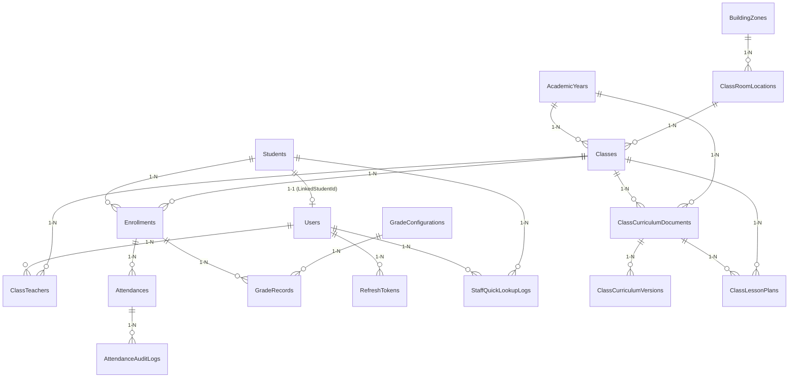

# TABLE RELATIONSHIPS

Quan hệ giữa các bảng được xác minh qua Fluent API cấu hình trong `ParishDbContext.cs` và các thuộc tính `[ForeignKey]` trên Entity Models.

## 1. Core Management (Thiếu nhi & Lớp học)
- **Users ↔ Students (1-1 Optional & Legacy n-1):**
  - `Users.LinkedStudentId -> Students.Id` (`TASK-01.1`, Phase 6): Quan hệ 1-1 tùy chọn với Unique Filtered Index (`WHERE "LinkedStudentId" IS NOT NULL`), `DeleteBehavior.SetNull`, liên kết tài khoản GLV Dự Bị (`ProbationaryTeacher`) về hồ sơ thiếu nhi gốc.
  - `Users.StudentId -> Students.Id` (`TASK-806`): Quan hệ hiện hữu giữ tương thích ngược cho tài khoản Thiếu nhi / Phụ huynh.
- **Enrollments ↔ Students (n-1):** Khóa ngoại `StudentId`. DeleteBehavior: `SetNull` (qua User) và ngầm định cascade qua bảng Enrollments (có SoftDelete chặn xoá vật lý).
- **Enrollments ↔ Classes (n-1):** Khóa ngoại `ClassRoomId`. `ClassRoom` chứa nhiều `Enrollment`. IsUnique composite index trên `(StudentId, ClassRoomId)`.
- **Classes ↔ AcademicYears (n-1):** Khóa ngoại `AcademicYearId` liên kết với niên khóa (`Classes.Session` phân tách `Morning` / `Afternoon`).
- **ClassTeachers ↔ Users (n-1):** Khóa ngoại `UserId`. DeleteBehavior: `SetNull`.
- **ClassTeachers ↔ Classes (n-1):** Khóa ngoại `ClassRoomId`. DeleteBehavior: `Cascade`.

## 2. Attendance & Grades (Điểm danh & Sổ điểm)
- **Attendances ↔ Enrollments (n-1):** Khóa ngoại `EnrollmentId`. DeleteBehavior ngầm định cascade.
- **AttendanceAuditLogs ↔ Attendances (n-1):** Khóa ngoại `AttendanceId`. DeleteBehavior: `Cascade`.
- **GradeRecords ↔ Enrollments (n-1):** Khóa ngoại `EnrollmentId`. DeleteBehavior: `Cascade`.
- **GradeRecords ↔ GradeConfigurations (n-1):** Khóa ngoại `GradeConfigurationId`. DeleteBehavior: `Cascade`.
- **AttendanceDisputeRequests ↔ Enrollments, Students, Classes, MassCampaigns (n-1):** Các khóa ngoại trỏ về thông tin buổi điểm danh bị khiếu nại.

## 3. Sacraments & Promotion (Bí tích & Kết chuyển)
- **StudentSacramentRecords ↔ Students (n-1):** Khóa ngoại `StudentId`. DeleteBehavior: `Cascade`.
- **SacramentApprovalBatches ↔ AcademicYears, Classes (n-1):** Khóa ngoại `AcademicYearId` (`Restrict`), `ClassRoomId` (`SetNull`).
- **SacramentApprovalItems ↔ SacramentApprovalBatches, Students, Enrollments (n-1):** DeleteBehavior: `Cascade`.
- **StudentCodeHistories ↔ Students, AcademicYears (n-1):** Khóa ngoại `StudentId` (`Cascade`), `SourceAcademicYearId` (`Restrict`). Index bổ sung trên `NewCode` phục vụ tra cứu ngược từ mã hiện hành sang mã năm cũ.

## 4. Facilities & Operations (Cơ sở vật chất)
- **ClassRoomLocations ↔ BuildingZones (n-1):** Khóa ngoại `BuildingZoneId`. DeleteBehavior: `Cascade`.
- **ClassSchedules ↔ Classes, ClassRoomLocations (1-1/n-1):** Khóa ngoại `ClassRoomId` (`Cascade`), `ClassRoomLocationId` (`Restrict`).
- **RoomIncidentReports ↔ ClassRoomLocations, Users (n-1):** Khóa ngoại `ClassRoomLocationId`, `ReporterUserId`. DeleteBehavior: `Cascade`.

## 5. Security (Bảo mật)
- **RefreshTokens ↔ Users (n-1):** Khóa ngoại `UserId`. DeleteBehavior: `Cascade`.

## 6. Internal Staff Quick Lookup (`FEAT-P5-01` - Tra cứu thiếu nhi nội bộ)
- **StaffQuickLookupLogs ↔ Users (n-1):** Khóa ngoại `UserId` (`[ForeignKey(nameof(UserId))]`). DeleteBehavior: `Cascade`. Index trên `(UserId, LookedUpAt)`.
- **StaffQuickLookupLogs ↔ Students (n-1):** Khóa ngoại `StudentId` (`[ForeignKey(nameof(StudentId))]`). DeleteBehavior: `Cascade`. Index trên `StudentId`.
- **LookupViewOptions (Bảng cấu hình độc lập):** Khóa chính `Id`, Unique Index trên `OptionCode`. Được seed sẵn 4 cấu hình chế độ xem (`OVERVIEW`, `ATTENDANCE_DETAIL`, `ACADEMIC_2Y_SACRAMENT`, `PARENT_CONTACT`) trong `ParishDbContext.OnModelCreating`.

## 7. Lesson Plans & Class Curriculum Versioning (`FEAT-P5-07`)
- **ClassCurriculumDocuments ↔ Classes, AcademicYears (n-1):** Khóa ngoại `ClassRoomId`, `AcademicYearId`. DeleteBehavior: `Cascade`. Index trên `(ClassRoomId, AcademicYearId)` và `AcademicYearId`.
- **ClassCurriculumDocuments ↔ Users (n-1):** Khóa ngoại `CreatedByUserId`, `UpdatedByUserId`. DeleteBehavior: `SetNull`.
- **ClassCurriculumVersions ↔ ClassCurriculumDocuments (n-1):** Khóa ngoại `ClassCurriculumDocumentId`. DeleteBehavior: `Cascade`. Index trên `(ClassCurriculumDocumentId, VersionNumber)` và `CreatedAt`.
- **ClassCurriculumVersions ↔ Users (n-1):** Khóa ngoại `CreatedByUserId`. DeleteBehavior: `SetNull`.
- **ClassLessonPlans ↔ Classes, AcademicYears (n-1):** DeleteBehavior: `Cascade`. Khóa ngoại `AssignedTeacherUserId` → `Users` (`SetNull`). Index trên `(ClassRoomId, LessonDate)`, `AcademicYearId`, `AssignedTeacherUserId`.
- **ClassLessonPlans ↔ ClassCurriculumDocuments (n-1):** Khóa ngoại `CurriculumDocumentId`. DeleteBehavior: `SetNull`. Index trên `CurriculumDocumentId`.



### 3. TABLE-INDEX.json
```json
{
    "database":  "PostgreSQL",
    "schemas":  [
                    {
                        "schemaName":  "public",
                        "tables":  [
                                       {
                                           "tableName":  "Students",
                                           "columns":  [
                                                           "Id",
                                                           "StudentCode",
                                                           "ChristianName",
                                                           "FirstName",
                                                           "LastName",
                                                           "Gender",
                                                           "DateOfBirth",
                                                           "BaptismDate",
                                                           "FirstCommunionDate",
                                                           "ConfirmationDate",
                                                           "BaoDongPromiseDate",
                                                           "CatechistPromiseDate",
                                                           "ParentPhone",
                                                           "IsActive",
                                                           "IsDeleted",
                                                           "DeletedAt"
                                                       ],
                                           "primaryKeys":  [
                                                               "Id"
                                                           ],
                                           "foreignKeys":  [

                                                           ],
                                           "indexes":  [
                                                           "IsDeleted",
                                                           "StudentCode",
                                                           "LastName, FirstName",
                                                           "ChristianName",
                                                           "BaoDongPromiseDate",
                                                           "CatechistPromiseDate"
                                                       ]
                                       },
                                       {
                                           "tableName":  "AcademicYears",
                                           "columns":  [
                                                           "Id",
                                                           "Name",
                                                           "StartDate",
                                                           "EndDate",
                                                           "IsCurrent"
                                                       ],
                                           "primaryKeys":  [
                                                               "Id"
                                                           ],
                                           "foreignKeys":  [

                                                           ],
                                           "indexes":  [

                                                       ]
                                       },
                                       {
                                           "tableName":  "Classes",
                                           "columns":  [
                                                           "Id",
                                                           "Name",
                                                           "GradeLevel",
                                                           "RoomName",
                                                           "Shift",
                                                           "Session",
                                                           "AcademicYearId",
                                                           "ClassRoomLocationId",
                                                           "IsGradeLocked",
                                                           "IsDeleted",
                                                           "DeletedAt"
                                                       ],
                                           "primaryKeys":  [
                                                               "Id"
                                                           ],
                                           "foreignKeys":  [
                                                               {
                                                                   "column":  "ClassRoomLocationId",
                                                                   "principalTable":  "ClassRoomLocations",
                                                                   "principalColumn":  "Id"
                                                               },
                                                               {
                                                                   "column":  "AcademicYearId",
                                                                   "principalTable":  "AcademicYears",
                                                                   "principalColumn":  "Id"
                                                               }
                                                           ],
                                           "indexes":  [
                                                           "IsDeleted",
                                                           "Session",
                                                           "GradeLevel, Session"
                                                       ]
                                       },
                                       {
                                           "tableName":  "Enrollments",
                                           "columns":  [
                                                           "Id",
                                                           "StudentId",
                                                           "ClassRoomId",
                                                           "EnrolledAt",
                                                           "IsDeleted",
                                                           "DeletedAt",
                                                           "IsPassed",
                                                           "EvaluationActionType",
                                                           "TeacherProposalStatus",
                                                           "TeacherProposalNote",
                                                           "ProposedGodparentName",
                                                           "ProposedBy",
                                                           "ProposedAt",
                                                           "AcademicYearId"
                                                       ],
                                           "primaryKeys":  [
                                                               "Id"
                                                           ],
                                           "foreignKeys":  [
                                                               {
                                                                   "column":  "ClassRoomId",
                                                                   "principalTable":  "Classes",
                                                                   "principalColumn":  "Id"
                                                               },
                                                               {
                                                                   "column":  "StudentId",
                                                                   "principalTable":  "Students",
                                                                   "principalColumn":  "Id"
                                                               }
                                                           ],
                                           "indexes":  [
                                                           "IsDeleted",
                                                           "StudentId, AcademicYearId",
                                                           "StudentId, ClassRoomId"
                                                       ]
                                       },
                                       {
                                           "tableName":  "Attendances",
                                           "columns":  [
                                                           "Id",
                                                           "EnrollmentId",
                                                           "AttendanceDate",
                                                           "AttendedMass",
                                                           "MassStatus",
                                                           "MassCheckInTime",
                                                           "ClassAttended",
                                                           "ClassStatus",
                                                           "ClassCheckInTime",
                                                           "IsMakeUp",
                                                           "OriginalMissedDate",
                                                           "Note",
                                                           "CreatedAt"
                                                       ],
                                           "primaryKeys":  [
                                                               "Id"
                                                           ],
                                           "foreignKeys":  [
                                                               {
                                                                   "column":  "EnrollmentId",
                                                                   "principalTable":  "Enrollments",
                                                                   "principalColumn":  "Id"
                                                               }
                                                           ],
                                           "indexes":  [
                                                           "EnrollmentId, AttendanceDate",
                                                           "AttendanceDate",
                                                           "DayOfWeek, AttendedMass",
                                                           "DayOfWeek"
                                                       ]
                                       },
                                       {
                                           "tableName":  "AttendanceAuditLogs",
                                           "columns":  [
                                                           "Id",
                                                           "AttendanceId",
                                                           "ActionType",
                                                           "OldValues",
                                                           "NewValues",
                                                           "ModifiedBy",
                                                           "Reason",
                                                           "IpAddress",
                                                           "CreatedAt"
                                                       ],
                                           "primaryKeys":  [
                                                               "Id"
                                                           ],
                                           "foreignKeys":  [
                                                               {
                                                                   "column":  "AttendanceId",
                                                                   "principalTable":  "Attendances",
                                                                   "principalColumn":  "Id"
                                                               }
                                                           ],
                                           "indexes":  [
                                                           "AttendanceId",
                                                           "CreatedAt",
                                                           "ActionType"
                                                       ]
                                       },
                                       {
                                           "tableName":  "ClassTeachers",
                                           "columns":  [
                                                           "Id",
                                                           "ClassRoomId",
                                                           "TeacherName",
                                                           "UserId",
                                                           "PhoneNumber",
                                                           "RoleInClass",
                                                           "AcademicYearId",
                                                           "AssignedAt"
                                                       ],
                                           "primaryKeys":  [
                                                               "Id"
                                                           ],
                                           "foreignKeys":  [
                                                               {
                                                                   "column":  "UserId",
                                                                   "principalTable":  "Users",
                                                                   "principalColumn":  "Id"
                                                               },
                                                               {
                                                                   "column":  "ClassRoomId",
                                                                   "principalTable":  "Classes",
                                                                   "principalColumn":  "Id"
                                                               },
                                                               {
                                                                   "column":  "AcademicYearId",
                                                                   "principalTable":  "AcademicYears",
                                                                   "principalColumn":  "Id"
                                                               }
                                                           ],
                                           "indexes":  [

                                                       ]
                                       },
                                       {
                                           "tableName":  "Users",
                                           "columns":  [
                                                           "Id",
                                                           "Username",
                                                           "PasswordHash",
                                                           "Email",
                                                           "PhoneNumber",
                                                           "FirstName",
                                                           "LastName",
                                                           "Role",
                                                           "IsActive",
                                                           "AccessFailedCount",
                                                           "LockoutEnd",
                                                           "CreatedAt",
                                                           "LastLoginAt",
                                                           "ChristianName",
                                                           "DateOfBirth",
                                                           "Address",
                                                           "AvatarUrl",
                                                           "ManagedGradeLevel",
                                                           "ClassTeacherId",
                                                           "StudentId",
                                                           "LinkedStudentId"
                                                       ],
                                           "primaryKeys":  [
                                                               "Id"
                                                           ],
                                           "foreignKeys":  [
                                                               {
                                                                   "column":  "ClassTeacherId",
                                                                   "principalTable":  "ClassTeachers",
                                                                   "principalColumn":  "Id"
                                                               },
                                                               {
                                                                   "column":  "StudentId",
                                                                   "principalTable":  "Students",
                                                                   "principalColumn":  "Id"
                                                               },
                                                               {
                                                                   "column":  "LinkedStudentId",
                                                                   "principalTable":  "Students",
                                                                   "principalColumn":  "Id"
                                                               }
                                                           ],
                                           "indexes":  [
                                                           "Username",
                                                           "Email",
                                                           "PhoneNumber",
                                                           "Role",
                                                           "ManagedGradeLevel",
                                                           "LinkedStudentId"
                                                       ]
                                       },
                                       {
                                           "tableName":  "RefreshTokens",
                                           "columns":  [
                                                           "Id",
                                                           "UserId",
                                                           "Token",
                                                           "ExpiresAt",
                                                           "CreatedAt",
                                                           "CreatedByIp",
                                                           "RevokedAt",
                                                           "RevokedByIp",
                                                           "ReplacedByToken"
                                                       ],
                                           "primaryKeys":  [
                                                               "Id"
                                                           ],
                                           "foreignKeys":  [
                                                               {
                                                                   "column":  "UserId",
                                                                   "principalTable":  "Users",
                                                                   "principalColumn":  "Id"
                                                               }
                                                           ],
                                           "indexes":  [
                                                           "Token",
                                                           "UserId"
                                                       ]
                                       },
                                       {
                                           "tableName":  "Announcements",
                                           "columns":  [
                                                           "Id",
                                                           "Title",
                                                           "Content",
                                                           "Scope",
                                                           "TargetGradeLevel",
                                                           "TargetClassRoomId",
                                                           "Priority",
                                                           "IsPinned",
                                                           "IsActive",
                                                           "CreatedBy",
                                                           "CreatedAt",
                                                           "ExpireAt"
                                                       ],
                                           "primaryKeys":  [
                                                               "Id"
                                                           ],
                                           "foreignKeys":  [
                                                               {
                                                                   "column":  "TargetClassRoomId",
                                                                   "principalTable":  "Classes",
                                                                   "principalColumn":  "Id"
                                                               }
                                                           ],
                                           "indexes":  [
                                                           "CreatedAt",
                                                           "Scope",
                                                           "TargetGradeLevel",
                                                           "IsPinned"
                                                       ]
                                       },
                                       {
                                           "tableName":  "BuildingZones",
                                           "columns":  [
                                                           "Id",
                                                           "ZoneName",
                                                           "ZoneCode",
                                                           "Description",
                                                           "DisplayOrder"
                                                       ],
                                           "primaryKeys":  [
                                                               "Id"
                                                           ],
                                           "foreignKeys":  [

                                                           ],
                                           "indexes":  [

                                                       ]
                                       },
                                       {
                                           "tableName":  "ClassRoomLocations",
                                           "columns":  [
                                                           "Id",
                                                           "BuildingZoneId",
                                                           "RoomName",
                                                           "FloorNumber",
                                                           "Capacity",
                                                           "EquipmentNotes",
                                                           "IsAvailable"
                                                       ],
                                           "primaryKeys":  [
                                                               "Id"
                                                           ],
                                           "foreignKeys":  [
                                                               {
                                                                   "column":  "BuildingZoneId",
                                                                   "principalTable":  "BuildingZones",
                                                                   "principalColumn":  "Id"
                                                               }
                                                           ],
                                           "indexes":  [
                                                           "BuildingZoneId, FloorNumber"
                                                       ]
                                       },
                                       {
                                           "tableName":  "RoomIncidentReports",
                                           "columns":  [
                                                           "Id",
                                                           "ClassRoomLocationId",
                                                           "ReporterUserId",
                                                           "DeviceType",
                                                           "Severity",
                                                           "Description",
                                                           "Status",
                                                           "ReportedAt",
                                                           "ResolvedAt",
                                                           "ResolutionNotes"
                                                       ],
                                           "primaryKeys":  [
                                                               "Id"
                                                           ],
                                           "foreignKeys":  [
                                                               {
                                                                   "column":  "ClassRoomLocationId",
                                                                   "principalTable":  "ClassRoomLocations",
                                                                   "principalColumn":  "Id"
                                                               },
                                                               {
                                                                   "column":  "ReporterUserId",
                                                                   "principalTable":  "Users",
                                                                   "principalColumn":  "Id"
                                                               }
                                                           ],
                                           "indexes":  [
                                                           "ClassRoomLocationId, Status",
                                                           "ReporterUserId"
                                                       ]
                                       },
                                       {
                                           "tableName":  "ClassSchedules",
                                           "columns":  [
                                                           "Id",
                                                           "ClassRoomId",
                                                           "ClassRoomLocationId",
                                                           "StartTime",
                                                           "EndTime",
                                                           "Notes",
                                                           "Shift"
                                                       ],
                                           "primaryKeys":  [
                                                               "Id"
                                                           ],
                                           "foreignKeys":  [
                                                               {
                                                                   "column":  "ClassRoomId",
                                                                   "principalTable":  "Classes",
                                                                   "principalColumn":  "Id"
                                                               },
                                                               {
                                                                   "column":  "ClassRoomLocationId",
                                                                   "principalTable":  "ClassRoomLocations",
                                                                   "principalColumn":  "Id"
                                                               }
                                                           ],
                                           "indexes":  [
                                                           "ClassRoomLocationId, DayOfWeek, StartTime",
                                                           "ClassRoomId"
                                                       ]
                                       },
                                       {
                                           "tableName":  "BranchHeadAssignments",
                                           "columns":  [
                                                           "Id",
                                                           "UserId",
                                                           "AcademicYearId",
                                                           "ManagedGradeLevel",
                                                           "AssignedByUserId",
                                                           "AssignedAt",
                                                           "Notes"
                                                       ],
                                           "primaryKeys":  [
                                                               "Id"
                                                           ],
                                           "foreignKeys":  [
                                                               {
                                                                   "column":  "UserId",
                                                                   "principalTable":  "Users",
                                                                   "principalColumn":  "Id"
                                                               },
                                                               {
                                                                   "column":  "AcademicYearId",
                                                                   "principalTable":  "AcademicYears",
                                                                   "principalColumn":  "Id"
                                                               },
                                                               {
                                                                   "column":  "AssignedByUserId",
                                                                   "principalTable":  "Users",
                                                                   "principalColumn":  "Id"
                                                               }
                                                           ],
                                           "indexes":  [
                                                           "AcademicYearId, ManagedGradeLevel",
                                                           "UserId"
                                                       ]
                                       },
                                       {
                                           "tableName":  "UserRoleHistory",
                                           "columns":  [
                                                           "Id",
                                                           "UserId",
                                                           "OldRole",
                                                           "NewRole",
                                                           "AcademicYearId",
                                                           "ChangedByUserId",
                                                           "ChangedAt",
                                                           "Reason"
                                                       ],
                                           "primaryKeys":  [
                                                               "Id"
                                                           ],
                                           "foreignKeys":  [
                                                               {
                                                                   "column":  "UserId",
                                                                   "principalTable":  "Users",
                                                                   "principalColumn":  "Id"
                                                               },
                                                               {
                                                                   "column":  "AcademicYearId",
                                                                   "principalTable":  "AcademicYears",
                                                                   "principalColumn":  "Id"
                                                               },
                                                               {
                                                                   "column":  "ChangedByUserId",
                                                                   "principalTable":  "Users",
                                                                   "principalColumn":  "Id"
                                                               }
                                                           ],
                                           "indexes":  [
                                                           "UserId, AcademicYearId",
                                                           "ChangedAt"
                                                       ]
                                       },
                                       {
                                           "tableName":  "ClassLessonDocuments",
                                           "columns":  [
                                                           "Id",
                                                           "ClassRoomId",
                                                           "AcademicYearId",
                                                           "FileName",
                                                           "StoredFileName",
                                                           "FilePath",
                                                           "ContentType",
                                                           "FileSize",
                                                           "Description",
                                                           "UploadedBy",
                                                           "UploadedAt"
                                                       ],
                                           "primaryKeys":  [
                                                               "Id"
                                                           ],
                                           "foreignKeys":  [
                                                               {
                                                                   "column":  "AcademicYearId",
                                                                   "principalTable":  "AcademicYears",
                                                                   "principalColumn":  "Id"
                                                               },
                                                               {
                                                                   "column":  "ClassRoomId",
                                                                   "principalTable":  "Classes",
                                                                   "principalColumn":  "Id"
                                                               }
                                                           ],
                                           "indexes":  [

                                                       ]
                                       },
                                       {
                                           "tableName":  "ClassCurriculumDocuments",
                                           "columns":  [
                                                           "Id",
                                                           "ClassRoomId",
                                                           "AcademicYearId",
                                                           "Title",
                                                           "Description",
                                                           "CurrentVersion",
                                                           "VersionNumber",
                                                           "ContentJson",
                                                           "LastAttachmentFileName",
                                                           "LastAttachmentFilePath",
                                                           "LastAttachmentFileSize",
                                                           "LastAttachmentContentType",
                                                           "CreatedBy",
                                                           "CreatedByUserId",
                                                           "CreatedAt",
                                                           "UpdatedBy",
                                                           "UpdatedByUserId",
                                                           "UpdatedAt",
                                                           "IsActive"
                                                       ],
                                           "primaryKeys":  [
                                                               "Id"
                                                           ],
                                           "foreignKeys":  [
                                                               {
                                                                   "column":  "ClassRoomId",
                                                                   "principalTable":  "Classes",
                                                                   "principalColumn":  "Id"
                                                               },
                                                               {
                                                                   "column":  "AcademicYearId",
                                                                   "principalTable":  "AcademicYears",
                                                                   "principalColumn":  "Id"
                                                               },
                                                               {
                                                                   "column":  "CreatedByUserId",
                                                                   "principalTable":  "Users",
                                                                   "principalColumn":  "Id"
                                                               },
                                                               {
                                                                   "column":  "UpdatedByUserId",
                                                                   "principalTable":  "Users",
                                                                   "principalColumn":  "Id"
                                                               }
                                                           ],
                                           "indexes":  [
                                                           "ClassRoomId, AcademicYearId",
                                                           "AcademicYearId"
                                                       ]
                                       },
                                       {
                                           "tableName":  "ClassCurriculumVersions",
                                           "columns":  [
                                                           "Id",
                                                           "ClassCurriculumDocumentId",
                                                           "VersionNumber",
                                                           "VersionTag",
                                                           "ChangeSummary",
                                                           "ContentJson",
                                                           "FileName",
                                                           "StoredFileName",
                                                           "FilePath",
                                                           "FileSize",
                                                           "ContentType",
                                                           "CreatedBy",
                                                           "CreatedByUserId",
                                                           "CreatedAt"
                                                       ],
                                           "primaryKeys":  [
                                                               "Id"
                                                           ],
                                           "foreignKeys":  [
                                                               {
                                                                   "column":  "ClassCurriculumDocumentId",
                                                                   "principalTable":  "ClassCurriculumDocuments",
                                                                   "principalColumn":  "Id"
                                                               },
                                                               {
                                                                   "column":  "CreatedByUserId",
                                                                   "principalTable":  "Users",
                                                                   "principalColumn":  "Id"
                                                               }
                                                           ],
                                           "indexes":  [
                                                           "ClassCurriculumDocumentId, VersionNumber",
                                                           "CreatedAt"
                                                       ]
                                       },
                                       {
                                           "tableName":  "ClassLessonPlans",
                                           "columns":  [
                                                           "Id",
                                                           "ClassRoomId",
                                                           "AcademicYearId",
                                                           "CurriculumDocumentId",
                                                           "WeekNumber",
                                                           "Semester",
                                                           "LessonDate",
                                                           "LiturgicalDay",
                                                           "LessonCode",
                                                           "TopicTitle",
                                                           "KeyPoints",
                                                           "AssignedTeacherUserId",
                                                           "AssignedTeacherName",
                                                           "EventNotes",
                                                           "IsExamDay",
                                                           "IsDayOff"
                                                       ],
                                           "primaryKeys":  [
                                                               "Id"
                                                           ],
                                           "foreignKeys":  [
                                                               {
                                                                   "column":  "ClassRoomId",
                                                                   "principalTable":  "Classes",
                                                                   "principalColumn":  "Id"
                                                               },
                                                               {
                                                                   "column":  "AcademicYearId",
                                                                   "principalTable":  "AcademicYears",
                                                                   "principalColumn":  "Id"
                                                               },
                                                               {
                                                                   "column":  "AssignedTeacherUserId",
                                                                   "principalTable":  "Users",
                                                                   "principalColumn":  "Id"
                                                               },
                                                               {
                                                                   "column":  "CurriculumDocumentId",
                                                                   "principalTable":  "ClassCurriculumDocuments",
                                                                   "principalColumn":  "Id"
                                                               }
                                                           ],
                                           "indexes":  [
                                                           "ClassRoomId, LessonDate",
                                                           "AcademicYearId",
                                                           "AssignedTeacherUserId",
                                                           "CurriculumDocumentId"
                                                       ]
                                       },
                                       {
                                           "tableName":  "GradeConfigurations",
                                           "columns":  [
                                                           "Id",
                                                           "AcademicYearId",
                                                           "GradeLevel",
                                                           "ClassRoomId",
                                                           "Semester",
                                                           "ScoreType",
                                                           "DisplayName",
                                                           "WeightFactor",
                                                           "ColumnIndex",
                                                           "IsSacramentExam",
                                                           "IsRequired",
                                                           "CreatedAt"
                                                       ],
                                           "primaryKeys":  [
                                                               "Id"
                                                           ],
                                           "foreignKeys":  [
                                                               {
                                                                   "column":  "AcademicYearId",
                                                                   "principalTable":  "AcademicYears",
                                                                   "principalColumn":  "Id"
                                                               },
                                                               {
                                                                   "column":  "ClassRoomId",
                                                                   "principalTable":  "Classes",
                                                                   "principalColumn":  "Id"
                                                               }
                                                           ],
                                           "indexes":  [
                                                           "AcademicYearId, GradeLevel, Semester"
                                                       ]
                                       },
                                       {
                                           "tableName":  "GradeRecords",
                                           "columns":  [
                                                           "Id",
                                                           "EnrollmentId",
                                                           "GradeConfigurationId",
                                                           "Score",
                                                           "Note",
                                                           "UpdatedBy",
                                                           "UpdatedAt"
                                                       ],
                                           "primaryKeys":  [
                                                               "Id"
                                                           ],
                                           "foreignKeys":  [
                                                               {
                                                                   "column":  "EnrollmentId",
                                                                   "principalTable":  "Enrollments",
                                                                   "principalColumn":  "Id"
                                                               },
                                                               {
                                                                   "column":  "GradeConfigurationId",
                                                                   "principalTable":  "GradeConfigurations",
                                                                   "principalColumn":  "Id"
                                                               }
                                                           ],
                                           "indexes":  [
                                                           "EnrollmentId, GradeConfigurationId"
                                                       ]
                                       },
                                       {
                                           "tableName":  "AbsenceRequests",
                                           "columns":  [
                                                           "Id",
                                                           "EnrollmentId",
                                                           "AbsenceDate",
                                                           "SessionType",
                                                           "Reason",
                                                           "ParentPhone",
                                                           "Status",
                                                           "ReviewNote",
                                                           "ReviewedBy",
                                                           "ReviewedAt",
                                                           "CreatedAt"
                                                       ],
                                           "primaryKeys":  [
                                                               "Id"
                                                           ],
                                           "foreignKeys":  [
                                                               {
                                                                   "column":  "EnrollmentId",
                                                                   "principalTable":  "Enrollments",
                                                                   "principalColumn":  "Id"
                                                               }
                                                           ],
                                           "indexes":  [

                                                       ]
                                       },
                                       {
                                           "tableName":  "AttendanceRuleConfigs",
                                           "columns":  [
                                                           "Id",
                                                           "ClassRoomId",
                                                           "SundayMassWeightPercent",
                                                           "ThursdayMassWeightPercent",
                                                           "ClassWeightPercent",
                                                           "LateMultiplier",
                                                           "PermittedAbsentMultiplier",
                                                           "MakeUpBonusRate",
                                                           "MinAttendanceRateForSacrament",
                                                           "UpdatedBy",
                                                           "UpdatedAt"
                                                       ],
                                           "primaryKeys":  [
                                                               "Id"
                                                           ],
                                           "foreignKeys":  [
                                                               {
                                                                   "column":  "ClassRoomId",
                                                                   "principalTable":  "Classes",
                                                                   "principalColumn":  "Id"
                                                               }
                                                           ],
                                           "indexes":  [

                                                       ]
                                       },
                                       {
                                           "tableName":  "grade_columns",
                                           "columns":  [
                                                           "id",
                                                           "academic_year",
                                                           "semester",
                                                           "class_id",
                                                           "column_code",
                                                           "column_name",
                                                           "coefficient",
                                                           "is_attendance_based",
                                                           "sort_order"
                                                       ],
                                           "primaryKeys":  [
                                                               "id"
                                                           ],
                                           "foreignKeys":  [

                                                           ],
                                           "indexes":  [
                                                           "academic_year, semester, class_id, column_code"
                                                       ]
                                       },
                                       {
                                           "tableName":  "student_grades",
                                           "columns":  [
                                                           "id",
                                                           "student_id",
                                                           "grade_column_id",
                                                           "semester",
                                                           "score",
                                                           "note",
                                                           "updated_by",
                                                           "updated_at"
                                                       ],
                                           "primaryKeys":  [
                                                               "id"
                                                           ],
                                           "foreignKeys":  [
                                                               {
                                                                   "column":  "grade_column_id",
                                                                   "principalTable":  "grade_columns",
                                                                   "principalColumn":  "id"
                                                               }
                                                           ],
                                           "indexes":  [
                                                           "student_id, grade_column_id, semester"
                                                       ]
                                       },
                                       {
                                           "tableName":  "attendance_score_rules",
                                           "columns":  [
                                                           "id",
                                                           "academic_year",
                                                           "semester",
                                                           "class_id",
                                                           "base_score",
                                                           "penalty_mass_unexcused",
                                                           "penalty_mass_excused",
                                                           "penalty_mass_late",
                                                           "penalty_class_unexcused",
                                                           "penalty_class_excused",
                                                           "penalty_class_late",
                                                           "min_score"
                                                       ],
                                           "primaryKeys":  [
                                                               "id"
                                                           ],
                                           "foreignKeys":  [

                                                           ],
                                           "indexes":  [
                                                           "academic_year, semester"
                                                       ]
                                       },
                                       {
                                           "tableName":  "grading_formulas",
                                           "columns":  [
                                                           "id",
                                                           "academic_year",
                                                           "semester",
                                                           "class_id",
                                                           "formula_expression",
                                                           "evaluation_rules"
                                                       ],
                                           "primaryKeys":  [
                                                               "id"
                                                           ],
                                           "foreignKeys":  [

                                                           ],
                                           "indexes":  [
                                                           "academic_year, semester"
                                                       ]
                                       },
                                       {
                                           "tableName":  "student_grade_summaries",
                                           "columns":  [
                                                           "id",
                                                           "student_id",
                                                           "academic_year",
                                                           "semester",
                                                           "average_score",
                                                           "classification",
                                                           "is_passed",
                                                           "updated_at"
                                                       ],
                                           "primaryKeys":  [
                                                               "id"
                                                           ],
                                           "foreignKeys":  [

                                                           ],
                                           "indexes":  [
                                                           "student_id, academic_year, semester"
                                                       ]
                                       },
                                       {
                                           "tableName":  "teacher_classes",
                                           "columns":  [
                                                           "id",
                                                           "user_id",
                                                           "class_id",
                                                           "role_in_class",
                                                           "academic_year",
                                                           "is_active"
                                                       ],
                                           "primaryKeys":  [
                                                               "id"
                                                           ],
                                           "foreignKeys":  [

                                                           ],
                                           "indexes":  [
                                                           "user_id, class_id, academic_year"
                                                       ]
                                       },
                                       {
                                           "tableName":  "parent_message_templates",
                                           "columns":  [
                                                           "id",
                                                           "title",
                                                           "category",
                                                           "scope",
                                                           "content_template",
                                                           "created_by",
                                                           "created_at"
                                                       ],
                                           "primaryKeys":  [
                                                               "id"
                                                           ],
                                           "foreignKeys":  [

                                                           ],
                                           "indexes":  [

                                                       ]
                                       },
                                       {
                                           "tableName":  "student_registration_requests",
                                           "columns":  [
                                                           "id",
                                                           "christian_name",
                                                           "first_name",
                                                           "last_name",
                                                           "gender",
                                                           "date_of_birth",
                                                           "baptism_date",
                                                           "baptism_parish",
                                                           "parent_full_name",
                                                           "parent_phone",
                                                           "parent_email",
                                                           "address",
                                                           "parish_sub_division",
                                                           "registration_type",
                                                           "academic_year_id",
                                                           "target_grade_level",
                                                           "baptism_certificate_path",
                                                           "status",
                                                           "rejection_reason",
                                                           "created_student_id",
                                                           "assigned_class_id",
                                                           "created_at",
                                                           "reviewed_by",
                                                           "reviewed_at",
                                                           "is_deleted",
                                                           "deleted_at"
                                                       ],
                                           "primaryKeys":  [
                                                               "id"
                                                           ],
                                           "foreignKeys":  [
                                                               {
                                                                   "column":  "academic_year_id",
                                                                   "principalTable":  "AcademicYears",
                                                                   "principalColumn":  "Id"
                                                               },
                                                               {
                                                                   "column":  "created_student_id",
                                                                   "principalTable":  "Students",
                                                                   "principalColumn":  "Id"
                                                               },
                                                               {
                                                                   "column":  "assigned_class_id",
                                                                   "principalTable":  "Classes",
                                                                   "principalColumn":  "Id"
                                                               }
                                                           ],
                                           "indexes":  [
                                                           "status, created_at",
                                                           "parent_phone, date_of_birth"
                                                       ]
                                       },
                                       {
                                           "tableName":  "PromotionRuleConfigs",
                                           "columns":  [
                                                           "Id",
                                                           "AcademicYearId",
                                                           "GradeLevel",
                                                           "MinYearAverage",
                                                           "MinAttendanceRate",
                                                           "RequireSacramentPassed",
                                                           "MinSacramentScore",
                                                           "NextGradeLevel",
                                                           "CreatedAt",
                                                           "UpdatedAt",
                                                           "IsDeleted",
                                                           "DeletedAt"
                                                       ],
                                           "primaryKeys":  [
                                                               "Id"
                                                           ],
                                           "foreignKeys":  [
                                                               {
                                                                   "column":  "AcademicYearId",
                                                                   "principalTable":  "AcademicYears",
                                                                   "principalColumn":  "Id"
                                                               }
                                                           ],
                                           "indexes":  [
                                                           "AcademicYearId, GradeLevel"
                                                       ]
                                       },
                                       {
                                           "tableName":  "StudentSacramentRecords",
                                           "columns":  [
                                                           "Id",
                                                           "StudentId",
                                                           "SacramentType",
                                                           "ReceivedDate",
                                                           "ParishName",
                                                           "PriestName",
                                                           "GodparentName",
                                                           "RegistryBookNumber",
                                                           "Notes",
                                                           "CreatedBy",
                                                           "CreatedAt",
                                                           "UpdatedBy",
                                                           "UpdatedAt",
                                                           "IsDeleted",
                                                           "DeletedAt"
                                                       ],
                                           "primaryKeys":  [
                                                               "Id"
                                                           ],
                                           "foreignKeys":  [
                                                               {
                                                                   "column":  "StudentId",
                                                                   "principalTable":  "Students",
                                                                   "principalColumn":  "Id"
                                                               }
                                                           ],
                                           "indexes":  [
                                                           "StudentId, SacramentType"
                                                       ]
                                       },
                                       {
                                           "tableName":  "SacramentApprovalBatches",
                                           "columns":  [
                                                           "Id",
                                                           "AcademicYearId",
                                                           "GradeLevel",
                                                           "ClassRoomId",
                                                           "SacramentType",
                                                           "Title",
                                                           "MinYearAverage",
                                                           "MinAttendanceRate",
                                                           "RequireSacramentExam",
                                                           "MinSacramentExamScore",
                                                           "PlannedCeremonyDate",
                                                           "CeremonyParish",
                                                           "CelebrantPriest",
                                                           "RegistryBookPrefix",
                                                           "Status",
                                                           "Notes",
                                                           "CreatedBy",
                                                           "CreatedAt",
                                                           "ApprovedBy",
                                                           "ApprovedAt",
                                                           "IsDeleted",
                                                           "DeletedAt"
                                                       ],
                                           "primaryKeys":  [
                                                               "Id"
                                                           ],
                                           "foreignKeys":  [
                                                               {
                                                                   "column":  "AcademicYearId",
                                                                   "principalTable":  "AcademicYears",
                                                                   "principalColumn":  "Id"
                                                               },
                                                               {
                                                                   "column":  "ClassRoomId",
                                                                   "principalTable":  "Classes",
                                                                   "principalColumn":  "Id"
                                                               }
                                                           ],
                                           "indexes":  [
                                                           "AcademicYearId, GradeLevel, SacramentType",
                                                           "Status",
                                                           "IsDeleted"
                                                       ]
                                       },
                                       {
                                           "tableName":  "SacramentApprovalItems",
                                           "columns":  [
                                                           "Id",
                                                           "BatchId",
                                                           "StudentId",
                                                           "EnrollmentId",
                                                           "ClassName",
                                                           "Semester1Average",
                                                           "Semester2Average",
                                                           "YearAverage",
                                                           "SacramentExamScore",
                                                           "MassAttendanceRate",
                                                           "ClassAttendanceRate",
                                                           "CombinedAttendanceRate",
                                                           "IsSystemEligible",
                                                           "IsSpecialExemption",
                                                           "IsApprovedForSacrament",
                                                           "GodparentName",
                                                           "AssignedRegistryNumber",
                                                           "EvaluationNote"
                                                       ],
                                           "primaryKeys":  [
                                                               "Id"
                                                           ],
                                           "foreignKeys":  [
                                                               {
                                                                   "column":  "BatchId",
                                                                   "principalTable":  "SacramentApprovalBatches",
                                                                   "principalColumn":  "Id"
                                                               },
                                                               {
                                                                   "column":  "StudentId",
                                                                   "principalTable":  "Students",
                                                                   "principalColumn":  "Id"
                                                               },
                                                               {
                                                                   "column":  "EnrollmentId",
                                                                   "principalTable":  "Enrollments",
                                                                   "principalColumn":  "Id"
                                                               }
                                                           ],
                                           "indexes":  [
                                                           "BatchId, StudentId",
                                                           "EnrollmentId"
                                                       ]
                                       },
                                       {
                                           "tableName":  "MassCampaigns",
                                           "columns":  [
                                                           "Id",
                                                           "AcademicYearId",
                                                           "ClassRoomId",
                                                           "Title",
                                                           "Description",
                                                           "StartDate",
                                                           "EndDate",
                                                           "ApplicableDaysCsv",
                                                           "TargetDaysCount",
                                                           "Status",
                                                           "CreatedBy",
                                                           "CreatedAt",
                                                           "UpdatedBy",
                                                           "UpdatedAt",
                                                           "IsDeleted",
                                                           "DeletedAt"
                                                       ],
                                           "primaryKeys":  [
                                                               "Id"
                                                           ],
                                           "foreignKeys":  [
                                                               {
                                                                   "column":  "AcademicYearId",
                                                                   "principalTable":  "AcademicYears",
                                                                   "principalColumn":  "Id"
                                                               },
                                                               {
                                                                   "column":  "ClassRoomId",
                                                                   "principalTable":  "Classes",
                                                                   "principalColumn":  "Id"
                                                               }
                                                           ],
                                           "indexes":  [
                                                           "AcademicYearId, ClassRoomId, Status",
                                                           "IsDeleted"
                                                       ]
                                       },
                                       {
                                           "tableName":  "MassCampaignRecords",
                                           "columns":  [
                                                           "Id",
                                                           "CampaignId",
                                                           "StudentId",
                                                           "EnrollmentId",
                                                           "AttendanceDate",
                                                           "Status",
                                                           "CheckInMethod",
                                                           "CheckInTime",
                                                           "Note",
                                                           "LastModifiedBy",
                                                           "LastModifiedAt"
                                                       ],
                                           "primaryKeys":  [
                                                               "Id"
                                                           ],
                                           "foreignKeys":  [
                                                               {
                                                                   "column":  "CampaignId",
                                                                   "principalTable":  "MassCampaigns",
                                                                   "principalColumn":  "Id"
                                                               },
                                                               {
                                                                   "column":  "StudentId",
                                                                   "principalTable":  "Students",
                                                                   "principalColumn":  "Id"
                                                               },
                                                               {
                                                                   "column":  "EnrollmentId",
                                                                   "principalTable":  "Enrollments",
                                                                   "principalColumn":  "Id"
                                                               }
                                                           ],
                                           "indexes":  [
                                                           "CampaignId, EnrollmentId, AttendanceDate",
                                                           "StudentId, AttendanceDate"
                                                       ]
                                       },
                                       {
                                           "tableName":  "StudentCodeHistories",
                                           "columns":  [
                                                           "Id",
                                                           "StudentId",
                                                           "SourceAcademicYearId",
                                                           "TargetAcademicYearId",
                                                           "OriginalCode",
                                                           "ArchivedYearCode",
                                                           "NewCode",
                                                           "RolloverOutcome",
                                                           "SourceClassName",
                                                           "TargetClassName",
                                                           "ChangedBy",
                                                           "ChangedAt"
                                                       ],
                                           "primaryKeys":  [
                                                               "Id"
                                                           ],
                                           "foreignKeys":  [
                                                               {
                                                                   "column":  "StudentId",
                                                                   "principalTable":  "Students",
                                                                   "principalColumn":  "Id"
                                                               },
                                                               {
                                                                   "column":  "SourceAcademicYearId",
                                                                   "principalTable":  "AcademicYears",
                                                                   "principalColumn":  "Id"
                                                               }
                                                           ],
                                           "indexes":  [
                                                           "OriginalCode",
                                                           "ArchivedYearCode",
                                                           "NewCode",
                                                           "StudentId, SourceAcademicYearId"
                                                       ]
                                       },
                                       {
                                           "tableName":  "AttendanceDisputeRequests",
                                           "columns":  [
                                                           "Id",
                                                           "EnrollmentId",
                                                           "StudentId",
                                                           "ClassRoomId",
                                                           "CampaignId",
                                                           "AttendanceDate",
                                                           "SessionScope",
                                                           "CurrentRecordedStatus",
                                                           "RequestedStatus",
                                                           "Reason",
                                                           "ParentPhoneLast4",
                                                           "Status",
                                                           "TeacherResponseNote",
                                                           "ReviewedBy",
                                                           "ReviewedAt",
                                                           "CreatedAt"
                                                       ],
                                           "primaryKeys":  [
                                                               "Id"
                                                           ],
                                           "foreignKeys":  [
                                                               {
                                                                   "column":  "EnrollmentId",
                                                                   "principalTable":  "Enrollments",
                                                                   "principalColumn":  "Id"
                                                               },
                                                               {
                                                                   "column":  "StudentId",
                                                                   "principalTable":  "Students",
                                                                   "principalColumn":  "Id"
                                                               },
                                                               {
                                                                   "column":  "ClassRoomId",
                                                                   "principalTable":  "Classes",
                                                                   "principalColumn":  "Id"
                                                               },
                                                               {
                                                                   "column":  "CampaignId",
                                                                   "principalTable":  "MassCampaigns",
                                                                   "principalColumn":  "Id"
                                                               }
                                                           ],
                                           "indexes":  [
                                                           "ClassRoomId, Status, CreatedAt",
                                                           "EnrollmentId, AttendanceDate, SessionScope"
                                                       ]
                                       },
                                       {
                                           "tableName":  "FeaturePermissionRules",
                                           "columns":  [
                                                           "Id",
                                                           "FeatureCode",
                                                           "MasterCode",
                                                           "DisplayName",
                                                           "Description",
                                                           "IconClass",
                                                           "TargetUrl",
                                                           "BadgeColor",
                                                           "AllowedRolesCsv",
                                                           "SacramentClassesOnly",
                                                           "SpecificClassIdsCsv",
                                                           "SortOrder",
                                                           "IsEnabled",
                                                           "UpdatedBy",
                                                           "UpdatedAt"
                                                       ],
                                           "primaryKeys":  [
                                                               "Id"
                                                           ],
                                           "foreignKeys":  [

                                                           ],
                                           "indexes":  [
                                                           "FeatureCode",
                                                           "MasterCode, IsEnabled, SortOrder"
                                                       ]
                                       },
                                       {
                                           "tableName":  "StaffQuickLookupLogs",
                                           "columns":  [
                                                           "Id",
                                                           "UserId",
                                                           "StudentId",
                                                           "SearchTerm",
                                                           "SelectedOption",
                                                           "IpAddress",
                                                           "LookedUpAt"
                                                       ],
                                           "primaryKeys":  [
                                                               "Id"
                                                           ],
                                           "foreignKeys":  [
                                                               {
                                                                   "column":  "UserId",
                                                                   "principalTable":  "Users",
                                                                   "principalColumn":  "Id"
                                                               },
                                                               {
                                                                   "column":  "StudentId",
                                                                   "principalTable":  "Students",
                                                                   "principalColumn":  "Id"
                                                               }
                                                           ],
                                           "indexes":  [
                                                           "UserId, LookedUpAt",
                                                           "StudentId"
                                                       ]
                                       },
                                       {
                                           "tableName":  "LookupViewOptions",
                                           "columns":  [
                                                           "Id",
                                                           "OptionCode",
                                                           "DisplayName",
                                                           "Description",
                                                           "IconClass",
                                                           "BadgeColor",
                                                           "SortOrder",
                                                           "IsActive"
                                                       ],
                                           "primaryKeys":  [
                                                               "Id"
                                                           ],
                                           "foreignKeys":  [

                                                           ],
                                           "indexes":  [
                                                           "OptionCode"
                                                       ]
                                       }
                                   ]
                    }
                ]
}
```