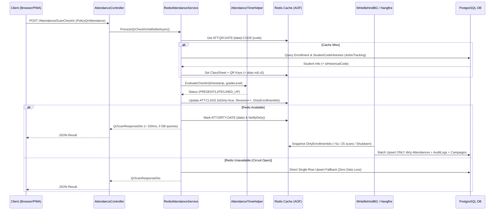

## 1. Feature Purpose

* **Mục đích nghiệp vụ:** Xử lý điểm danh tốc độ cao bằng mã QR cho thiếu nhi tại cổng nhà thờ hoặc lớp học. Đảm bảo hệ thống vẫn hoạt động liên tục khi rớt mạng (Offline-first) bằng cách lưu tạm dưới Client (IndexedDB) và đồng bộ hàng loạt (Sync) lên Server khi có mạng.
* **User input:**
* *Online:* `QrScanRequestDto` chứa `StudentCode`, `ScanTimestamp`, `SessionMode`, `CampaignId`.
* *Undo (5s):* `UndoScanRequestDto` chứa `EnrollmentId`, `ClassId`, `StudentCode`, `AttendanceDate`, `ActivityType`, `SessionMode`.
* *Offline Sync:* `OfflineSyncQueueRequestDto` chứa danh sách `OfflineSyncItemDto` (các bản ghi điểm danh lưu tạm trong IndexedDB).

* **Output:**
* *Online:* `QrScanResponseDto` (Kết quả điểm danh, Trạng thái, Thông tin thiếu nhi, kèm `EnrollmentId`, `ClassId`, `SessionMode`, `ScanDate`, và cờ cảnh báo thẻ cũ `IsHistoricalCode`, `OldCode`, `CurrentCode`, `WarningMessage`).
* *Undo (5s):* JSON `{ success, message }`.
* *Offline Sync:* JSON phản hồi số lượng bản ghi đã đồng bộ (`syncedCount`) và danh sách `clientIds` đã xử lý.

* **Các trạng thái có thể xảy ra:**
* Thành công (Mới điểm danh).
* Trùng lặp (Đã điểm danh trước đó).
* Lỗi (Không tìm thấy mã thiếu nhi).
* Xung đột dữ liệu khi đồng bộ Offline (Cần hợp nhất trạng thái).

## 2. Execution Flow

### Flow 1: Fast QR Check-in (Online Mode - Redis-First & Write-Behind Coalesced Flush, `TASK-INF-08`)

1. **Entry point:** HTTP POST `/Attendance/ScanCheckIn` (`[EnableRateLimiting(SecurityExtensions.PolicyQrAttendance)]`: TokenBucket 60 req/s bền vững, burst 180 req, queue 60 — không chặn HTTP 429 khi 20–30 máy GLV quét đồng thời sau 1 IP NAT Wi-Fi nhà thờ) nhận `QrScanRequestDto` (`StudentCode`, `SessionMode`, `ScanTimestamp`, `CampaignId`).

2. **Auth Principal Cache & Validation:** `CookieAuthenticationEvents.OnValidatePrincipal` đọc trạng thái nhân sự ngắn hạn từ `ICacheService` (`auth:user_state:{userId}`, TTL 60s) để tránh truy vấn bảng `Users` trên từng lượt quét. `AttendanceController.ScanCheckIn` kiểm tra `StudentCode` không được rỗng.

3. **Controller processing:** Chuyển `QrScanRequestDto` sang `IRedisAttendanceService.ProcessQrCheckInViaRedisAsync` (KHÔNG còn gọi đồng bộ `SyncDirtyAttendancesToDatabaseAsync` trực tiếp trên mỗi lượt quét).

4. **Cache Lookup, Negative Cache & Historical Code Fallback:** Tìm khóa `ATT:QR:DATE:{date}:CODE:{code}` trên Redis (Job `PreWarmDailyAttendanceAndTasksAsync` chạy theo múi giờ Việt Nam UTC+7 đã pre-warm sẵn cả mã chính thức lẫn alias mã năm cũ từ `StudentCodeHistories` và trạng thái chiến dịch `ATT:CAMPAIGN:CLASS:{classId}:DATE:{date}`). Nếu Cache Miss: kiểm tra Negative Cache `ATT:QR:MISS:DATE:{date}:CODE:{code}` (TTL 30s) để chặn spam mã sai, sau đó mới truy vấn PostgreSQL với `.AsNoTracking()` + projection gọn (`AcademicYears` từ cache, `Enrollments`, `StudentCodeHistories`), nạp ClassSheet (single-flight theo lớp) và cache alias mã cũ đạt `O(1)` cho các lần quét sau.

5. **Business logic (Time Evaluation & Campaign Cache):** Gọi `AttendanceTimeHelper.EvaluateCheckIn()` đánh giá thời điểm quét (kết hợp `SessionMode` nếu được chọn trên HUD) để xác định ca học/lễ và tính toán trạng thái (`PRESENT`, `LATE`, `LINED_UP`). Ở chế độ `CAMPAIGN_MONTH`, chiến dịch đang mở được đọc từ cache `ATT:CAMPAIGN:CLASS:{classId}:DATE:{date}` (TTL 5 phút) và dedup qua `ATT:CAMPAIGN:SCAN:{campaignId}:ENR:{enrollmentId}:DATE:{date}`.

6. **Thread-Safe Redis Update (Striped Locks):** Dưới per-class striped lock (`ClassSheetLocks`), đọc/cập nhật lưới điểm danh lớp `ATT:CLASS:{classId}:DATE:{date}` cho đúng học sinh vừa quét, tăng `Revision`, đánh dấu `IsDirty = true`, ghi `EnrollmentId` vào `DirtyEnrollmentIds` cùng thông tin audit riêng theo học sinh (`DirtyAuditMetaByEnrollment`) và hàng đợi chiến dịch (`PendingCampaignCheckIns`, nếu có).

7. **Adaptive Persistence (Write-Behind Batch vs. Redis-Down Single-Row Fallback):**
   * **Khi Redis khỏe (`_cache.IsRedisAvailable == true`, Redis AOF `appendfsync everysec`):** Đánh dấu `classId` vào `ATT:DIRTY:DATE:{date}` (dưới `DirtyIndexLocks`, bỏ qua SET dư thừa nếu lớp đã dirty), gửi tín hiệu non-blocking vào `IAttendanceFlushSignal.NotifyDirty(...)` để `AttendanceWriteBehindBackgroundService` gom nhóm và Batch Upsert xuống PostgreSQL theo cửa sổ **5 giây** (hoặc ngay khi gom đủ **25 lượt quét**), đồng thời tự động Flush toàn bộ khi ứng dụng tắt (`StopAsync`) và có Hangfire `syncback-redis-attendance-to-db` (2 phút/lần) + API `POST /Attendance/FlushRedisToDatabase` làm lớp dự phòng. Trong mỗi lần Flush (`FlushSingleClassByIdAsync`), chỉ truy vấn & Upsert đúng các `DirtyEnrollmentIds` (không chèn dòng vắng thừa cho các học sinh chưa quét) và dùng `Revision` để không xóa cờ `IsDirty` nếu có lượt quét mới vừa đến trong lúc ghi DB.
   * **Khi Redis sự cố / Circuit Breaker mở (`_cache.IsRedisAvailable == false`):** Tự động Fallback gọi `PersistSingleQrScanFallbackAsync` ghi trực tiếp **duy nhất 1 bản ghi** học sinh đó xuống PostgreSQL trong transaction để đảm bảo **0% mất dữ liệu điểm danh**.

8. **Response:** Trả về JSON `QrScanResponseDto` (bao gồm `EnrollmentId`, `ClassId`, `SessionMode`, `ScanDate`, và cờ cảnh báo mã cũ `IsHistoricalCode`, `OldCode`, `CurrentCode`, `WarningMessage`) với độ trễ hot path `< 150ms` (0 truy vấn DB trực tiếp khi Cache Hit) để UI phát âm thanh và kích hoạt đếm lùi hoàn tác 5 giây.

### Flow 2: Offline Synchronization (kèm `HistoricalCodes` & Tiền đồng bộ Redis)

1. **Pre-warm Offline Cache:** Client gọi `GET /Attendance/GetOfflineStudentsCache?classId=...` (`[EnableRateLimiting(SecurityExtensions.PolicyQrAttendance)]`) để nạp danh sách học sinh kèm `HistoricalCodes` vào IndexedDB (`offline-attendance.js`). Server đệm danh sách thiếu nhi niên khóa hiện hành + mã cũ trên Redis (`ATT:OFFLINE:STUDENTS:YEAR:{yearId}`, TTL 5 phút) và lọc theo quyền truy cập lớp đã cache (`ATT:CLASSES:YEAR:{yearId}`, `ATT:AUTH:TEACHER:{userId}:YEAR:{yearId}`, TTL 2 phút).

2. **Entry point Sync:** HTTP POST `/Attendance/SyncOfflineQueue` (`[EnableRateLimiting(SecurityExtensions.PolicyQrAttendance)]`).

3. **Validation & Pre-Flush:** Kiểm tra quyền `GetAuthorizedClassesAsync` của người đồng bộ trên các lớp liên quan, truy vấn danh sách `Enrollments` hợp lệ bằng `.AsNoTracking()` + projection gọn, và gọi `IRedisAttendanceService.SyncDirtyClassesForPartitionsAsync` cho các phân vùng `(ClassRoomId, AttendanceDate)` bị chạm tới nhằm đảm bảo mọi lượt quét QR còn đang chờ trên Redis được ghi xuống DB trước khi hợp nhất xung đột và hủy cache `ClassSheet`.

4. **Database queries:** Truy vấn bảng `Attendances` của các học sinh và ngày tương ứng vào một `Dictionary` trong bộ nhớ.

5. **Business logic (Conflict Resolution):**
* Duyệt qua từng bản ghi Offline. Nếu là quét QR (`RecordType == "QR_SCAN"`), ưu tiên ghi đè nếu trạng thái có lợi hơn hoặc thời gian quét sớm hơn bản ghi hiện tại trên DB.

* Dùng hàm `PickBetterAttendanceStatus` để ưu tiên trạng thái (VD: `LINED_UP` > `PRESENT` > `LATE` > `ABSENT_PERMITTED`).

6. **Database Write:** Dùng `CreateExecutionStrategy` và `BeginTransactionAsync` để Upsert (thêm mới hoặc cập nhật) dữ liệu vào bảng `Attendances` + `AttendanceAuditLogs`, sau đó xóa cache `ClassSheet`, `ClassSessionInfo` và `staff_lookup:student_360:{studentId}`.

7. **Response:** Trả về JSON chứa số lượng đã đồng bộ `syncedCount` và `syncedClientIds`.

### Flow 3: Undo QR Check-in (5-Second Window - `FEAT-P5-04`)

1. **Online Undo:** Client nhấn nút Hoàn tác trong 5 giây -> `POST /Attendance/UndoScanCheckIn` với `UndoScanRequestDto` (`EnrollmentId`, `ClassId`, `StudentCode`, `AttendanceDate`, `ActivityType`, `SessionMode`) -> `AttendanceController.UndoScanCheckIn` kiểm tra `EnrollmentId > 0` -> gọi `IRedisAttendanceService.UndoScanCheckInAsync` -> reset cờ điểm danh trên Redis ClassSheet (`ATT:CLASS:{classId}:DATE:{date}`, `IsDirty = true`) và cập nhật trực tiếp xuống PostgreSQL (`Attendances`, `MassCampaignRecords` nếu `ActivityType` chứa `"CHIẾN DỊCH"`).
2. **Offline Undo:** Client gọi `ParishOfflineEngine.undoOfflineQrScan(clientRecordId)` (`wwwroot/js/offline-attendance.js`) để xóa bản ghi vừa lưu khỏi IndexedDB `STORE_PENDING` trước khi đồng bộ.

## 3. Code Mapping

* `ManagerStudentCaltholic.Controllers.AttendanceController` | `ScanQr`, `ScanCheckIn`, `UndoScanCheckIn`, `GetOfflineStudentsCache`, `SyncOfflineQueue`, `SaveBatch`, `FlushRedisToDatabase` | `Controllers/AttendanceController.cs` | Controller tiếp nhận Request điểm danh QR, hoàn tác, đồng bộ offline và kiểm soát rate limit `PolicyQrAttendance`.

* `ManagerStudentCaltholic.Services.RedisAttendanceService` | `PreWarmDailyAttendanceAndTasksAsync`, `ProcessQrCheckInViaRedisAsync`, `UndoScanCheckInAsync`, `FlushClassToDatabaseAsync`, `SyncDirtyClassesForPartitionsAsync`, `SyncDirtyAttendancesToDatabaseAsync` | `Services/RedisAttendanceService.cs` | Logic lưu cache (striped lock + revision), quét QR 0-DB-query, tra cứu mã cũ, fallback single-row khi Redis sự cố, hoàn tác và batch upsert chỉ đúng dòng dirty.

* `ManagerStudentCaltholic.Services.AttendanceWriteBehindBackgroundService` & `AttendanceWriteBehindSignal` | `ExecuteAsync`, `StopAsync`, `NotifyDirty` | `Services/AttendanceWriteBehindBackgroundService.cs` | Hosted service gom nhóm Write-Behind ~5 giây (hoặc ngưỡng 25 lượt quét), quét khôi phục Redis AOF lúc khởi động và flush cưỡng bức trước khi container dừng.

* `ManagerStudentCaltholic.Extensions.SecurityExtensions` | `AddAppRateLimiter`, `PolicyQrAttendance` | `Extensions/SecurityExtensions.cs` | Cấu hình TokenBucket Rate Limiter cho điểm danh QR (60 req/s, burst 180, queue 60) tương thích 20–30 máy GLV sau 1 IP NAT Wi-Fi nhà thờ, giữ nghiêm ngặt `PolicyPublicLookup` & `PolicyAuth`.

* `ManagerStudentCaltholic.Services.AttendanceTimeHelper` | `EvaluateCheckIn` | `Services/AttendanceTimeHelper.cs` | Xác định ca sinh hoạt và tính độ trễ.

* `ParishOfflineEngine` | `prefetchStudentsCache`, `processOfflineQrScan`, `undoOfflineQrScan`, `syncPendingAttendances` | `wwwroot/js/offline-attendance.js` | Bộ xử lý lưu đệm IndexedDB (kèm `HistoricalCodes`) và hoàn tác ngoại tuyến.

## 4. Data Mapping

* **Input models:** `QrScanRequestDto`, `UndoScanRequestDto`, `OfflineSyncQueueRequestDto`.

* **DTOs:** `QrScanResponseDto` (có `EnrollmentId`, `ClassId`, `SessionMode`, `ScanDate`, `IsHistoricalCode`, `OldCode`, `CurrentCode`, `WarningMessage`), `OfflineStudentCacheItemDto` (có `HistoricalCodes`).

* **Entity models:** `Attendance`, `Enrollment`, `ClassRoom`, `Student`, `StudentCodeHistory`, `MassCampaignRecord`.

* **Database tables:** `Attendances`, `Enrollments`, `Students`, `StudentCodeHistories`, `MassCampaignRecords`.

* **Important columns:** `Attendances.EnrollmentId`, `Attendances.AttendanceDate`, `Attendances.MassCheckInTime`, `Attendances.MassStatus`.

* **Relationships:** `Attendance` n-1 `Enrollment`, `Enrollment` n-1 `Student` & `ClassRoom`.

* **Redis Keys:**
  * `ATT:QR:DATE:{date}:CODE:{code}` (O(1) Lookup cho cả mã hiện hành và alias mã năm cũ)
  * `ATT:QR:MISS:DATE:{date}:CODE:{code}` (Negative cache 30s chặn spam mã sai)
  * `ATT:CLASS:{classId}:DATE:{date}` (Class Sheet Payload kèm `Revision`, `DirtyEnrollmentIds`, `DirtyAuditMetaByEnrollment`, `PendingCampaignCheckIns`)
  * `ATT:SESSION:CLASS:{classId}:DATE:{date}` (Session context & checklist)
  * `ATT:DIRTY:DATE:{date}` (Dirty partitions index)
  * `ATT:CAMPAIGN:CLASS:{classId}:DATE:{date}` & `ATT:CAMPAIGN:SCAN:{campaignId}:ENR:{enrollmentId}:DATE:{date}` (Cache chiến dịch 1 tháng)
  * `ATT:CLASSES:YEAR:{academicYearId}`, `ATT:META:CLASS:{classId}`, `ATT:AUTH:TEACHER:{userId}:YEAR:{academicYearId}` (Cache phân quyền & metadata lớp 2 phút)
  * `ATT:OFFLINE:STUDENTS:YEAR:{academicYearId}` (Cache danh sách tải trước Offline 5 phút)
  * `auth:user_state:{userId}` (Cache trạng thái xác thực phiên GLV 60 giây trong `OnValidatePrincipal`)

## 5. Business Rules

* **Rule 1 - Điều kiện Khung Giờ (Time Conditions):** Lễ Thứ Năm tính từ 17:30 - 19:30 (luôn `PRESENT`). Lễ Chúa Nhật 06:20 - 08:20 (Trước 06:35 là `LINED_UP`, trước 07:00 là `PRESENT`, sau đó là `LATE`). Học Sáng (KT, RL, TS) trễ sau 09:30. Học Chiều (BĐ) trễ sau 15:15.

* **Rule 2 - Chống quét trùng (Duplicate Check):** UI Client khóa 3s (`3000ms`, qua `recentScannedCodesMap` trong `ScanQr.cshtml`) giữa các lần quét cùng 1 thẻ. Backend kiểm tra biến `AttendedMass` / `ClassAttended` trên Redis, nếu đã `true` sẽ trả về cờ `IsDuplicate = true`.

* **Rule 3 - Hợp nhất Offline (Conflict Resolution):** Khi có nhiều thiết bị cùng đẩy dữ liệu offline cho 1 học sinh, hệ thống ưu tiên lưu `CheckInTime` sớm nhất và trạng thái có lợi nhất (Rank: `LINED_UP` > `PRESENT` > `LATE` > `ABSENT_PERMITTED`).

* **Rule 4 - Ưu tiên nguồn dữ liệu:** Lượt quét QR (RecordType = `QR_SCAN`) luôn ghi đè bản ghi thủ công từ lưới Sổ lớp (RecordType = `BATCH_ROW`) nếu phát hiện học sinh đã quét QR có mặt trước đó.

## 6. State Transitions

| Current State | Condition / Event | Next State | Source |
| --- | --- | --- | --- |
| `ABSENT_UNPERMITTED` | Quét QR trước 06:35 Chúa Nhật | `LINED_UP` | `AttendanceTimeHelper.EvaluateCheckIn`

 |
| `ABSENT_UNPERMITTED` | Quét QR trong khung 06:35 - 07:00 | `PRESENT` | `AttendanceTimeHelper.EvaluateCheckIn`

 |
| `PRESENT` (Offline Sync) | Đồng bộ QR có giờ quét muộn hơn DB | Giữ nguyên `PRESENT` (Bỏ qua đợt đồng bộ mới) | `AttendanceController.SyncOfflineQueue`

 |
| `IsDirty = false` (Redis) | Phát sinh lượt quét QR thành công | `IsDirty = true` | `RedisAttendanceService.ProcessQrCheckInViaRedisAsync`

 |
| `IsDirty = true` (Redis) | Hàm SyncDirtyAttendances chạy xong | `IsDirty = false` | `RedisAttendanceService.SyncDirtyAttendancesToDatabaseAsync`

 |
| `PRESENT` / `LATE` / `LINED_UP` | Người dùng bấm Hoàn tác trong 5s (`UndoScanCheckIn`) | `ABSENT_UNPERMITTED` | `RedisAttendanceService.UndoScanCheckInAsync` |

## 7. Dependencies

* **Direct dependencies:** `ParishDbContext`, `ICacheService` (Redis kèm Circuit Breaker 30s & `IMemoryCache` fallback), `ILogger`.

* **Database dependencies:** Tables `Attendances`, `Enrollments`, `Classes`, `Students`, `StudentCodeHistories`, `MassCampaignRecords`.

* **External services:** Redis Server (High-throughput Cache).

* **Shared components:** `AttendanceTimeHelper`.

## 8. Change Impact

* **High impact:**
* `RedisClassAttendancePayload` (DTO): Bất kỳ thay đổi cấu trúc nào cũng sẽ làm hỏng dữ liệu serialize/deserialize trên Redis, ảnh hưởng trực tiếp đến Sổ điểm danh Grid và Quét QR.

* `AttendanceTimeHelper.EvaluateCheckIn`: Đổi khung giờ ở đây sẽ thay đổi toàn bộ logic tính trễ/đúng giờ của cả giáo xứ.

* **Medium impact:**
* `SyncOfflineQueue`: Thuật toán `PickBetterAttendanceStatus` nếu sửa sai sẽ gây thiệt thòi điểm chuyên cần khi đồng bộ thiết bị của GLV.

* **Low impact:** UI `ScanQr.cshtml`, âm thanh Beep qua Web Audio API (chỉ chạy ở client).

## 9. Testing Recommendations

* **Happy path:**
* Quét QR hợp lệ trong khung giờ Lễ CN (06:40) -> Server trả về `Success = true`, `Status = PRESENT`.
* Quét QR hợp lệ trong khung giờ Học GL (09:40) -> Server trả về `Status = LATE`.

* **Invalid input:**
* Quét mã QR rỗng hoặc chứa ký tự đặc biệt -> Trả về `Success = false`.

* **Boundary values:**
* Quét đúng 06:34:59 sáng Chúa nhật -> Phải ghi nhận `LINED_UP`.
* Quét đúng 06:35:00 sáng Chúa nhật -> Phải ghi nhận `PRESENT`.

* **Failure scenarios (Offline-First):**
* Tắt WiFi, dùng Súng quét mã -> Nhận diện lưu vào IndexedDB. Bật WiFi, bấm "Đồng bộ ngay" -> Server tiếp nhận và lưu đúng `CheckInTime` ban đầu.

* **Conflict scenarios:**
* Cùng 1 học sinh, Thiết bị A đồng bộ `LATE` (quét lúc 07:10), Thiết bị B đồng bộ `PRESENT` (quét lúc 06:50). Server phải giữ trạng thái `PRESENT` và thời gian `06:50`.

* **Cache Fallback:**
* Xóa trắng toàn bộ Redis (FlushAll). Quét QR một học sinh hợp lệ. Hệ thống phải tự động truy vấn PostgreSQL, nạp lại Cache (Pre-warm) mà không văng lỗi.

---

### Component Mapping

| Feature | Controller | Service | Repository | Model/Entity | View / Razor | Database Table |
| --- | --- | --- | --- | --- | --- | --- |
| QR Check-in | `AttendanceController` | `RedisAttendanceService` | `NOT_FOUND` | `Attendance`, `StudentCodeHistory` | `ScanQr.cshtml` | `Attendances`, `StudentCodeHistories` |
| QR Undo (5s) | `AttendanceController` (`UndoScanCheckIn`) | `RedisAttendanceService` (`UndoScanCheckInAsync`) | `NOT_FOUND` | `Attendance`, `MassCampaignRecord` | `ScanQr.cshtml` | `Attendances`, `MassCampaignRecords` |
| Fast Grid Save | `AttendanceController` | `RedisAttendanceService` | `NOT_FOUND` | `Attendance` | `Index.cshtml` | `Attendances` |
| Offline Sync | `AttendanceController` | `NOT_FOUND` | `NOT_FOUND` | `Attendance`, `StudentCodeHistory` | `Index.cshtml`, `offline-attendance.js` | `Attendances`, `StudentCodeHistories` |
| Time Evaluation | `NOT_FOUND` | `AttendanceTimeHelper` | `NOT_FOUND` | `NOT_FOUND` | `NOT_FOUND` | `NOT_FOUND` |