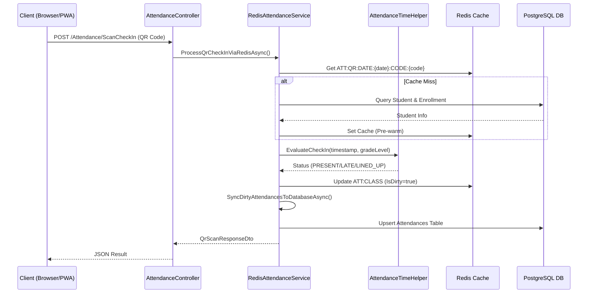

## 1. Feature Purpose

* **Mục đích nghiệp vụ:** Xử lý điểm danh tốc độ cao bằng mã QR cho thiếu nhi tại cổng nhà thờ hoặc lớp học. Đảm bảo hệ thống vẫn hoạt động liên tục khi rớt mạng (Offline-first) bằng cách lưu tạm dưới Client (IndexedDB) và đồng bộ hàng loạt (Sync) lên Server khi có mạng.
* **User input:**
* *Online:* `QrScanRequestDto` chứa `StudentCode` và `ScanTimestamp`.
* *Offline Sync:* `OfflineSyncQueueRequestDto` chứa danh sách `OfflineSyncItemDto` (các bản ghi điểm danh lưu tạm).

* **Output:**
* *Online:* `QrScanResponseDto` (Kết quả điểm danh, Trạng thái, Thông tin thiếu nhi).
* *Offline Sync:* JSON phản hồi số lượng bản ghi đã đồng bộ (`syncedCount`) và danh sách `clientIds` đã xử lý.

* **Các trạng thái có thể xảy ra:**
* Thành công (Mới điểm danh).
* Trùng lặp (Đã điểm danh trước đó).
* Lỗi (Không tìm thấy mã thiếu nhi).
* Xung đột dữ liệu khi đồng bộ Offline (Cần hợp nhất trạng thái).

## 2. Execution Flow

### Flow 1: Fast QR Check-in (Online Mode)

1. **Entry point:** HTTP POST `/Attendance/ScanCheckIn` nhận mã QR.

2. **Validation:** `AttendanceController` kiểm tra `StudentCode` không được rỗng.

3. **Controller processing:** Chuyển `QrScanRequestDto` sang `IRedisAttendanceService.ProcessQrCheckInViaRedisAsync`.

4. **Cache Lookup:** Tìm khóa `ATT:QR:DATE:{date}:CODE:{code}` trên Redis. Nếu không có (Cache Miss), truy vấn PostgreSQL (bảng `Enrollments`, `Classes`) để lấy thông tin và nạp lại Cache (Pre-warm).

5. **Business logic (Time Evaluation):** Gọi `AttendanceTimeHelper.EvaluateCheckIn()` đánh giá thời điểm quét để xác định ca học/lễ và tính toán trạng thái (`PRESENT`, `LATE`, `LINED_UP`).

6. **Redis Update:** Lấy lưới điểm danh lớp `ATT:CLASS:{classId}:DATE:{date}`, cập nhật trạng thái `AttendedMass` / `ClassAttended` cho học sinh tương ứng. Đánh dấu `IsDirty = true`.

7. **Write-Through DB Sync:** Gọi ngay `SyncDirtyAttendancesToDatabaseAsync()` để ghi xuống PostgreSQL (tránh mất dữ liệu nếu Redis sập).

8. **Response:** Trả về JSON `QrScanResponseDto` với thông tin chi tiết để UI phát âm thanh tương ứng.

### Flow 2: Offline Synchronization

1. **Entry point:** HTTP POST `/Attendance/SyncOfflineQueue`.

2. **Request parameters:** Danh sách các lượt điểm danh quét lúc rớt mạng (`OfflineSyncQueueRequestDto`).

3. **Validation:** Kiểm tra quyền `CanAccessClassAsync` của người đồng bộ trên các lớp liên quan.

4. **Database queries:** Truy vấn toàn bộ bảng `Attendances` của các học sinh và ngày tương ứng vào một `Dictionary` trong bộ nhớ.

5. **Business logic (Conflict Resolution):**
* Duyệt qua từng bản ghi Offline. Nếu là quét QR (`RecordType == "QR_SCAN"`), ưu tiên ghi đè nếu trạng thái có lợi hơn hoặc thời gian quét sớm hơn bản ghi hiện tại trên DB.

* Dùng hàm `PickBetterAttendanceStatus` để ưu tiên trạng thái (VD: `PRESENT` > `LATE` > `ABSENT_PERMITTED`).

6. **Database Write:** Dùng `CreateExecutionStrategy` và `BeginTransactionAsync` để Upsert (thêm mới hoặc cập nhật) dữ liệu vào bảng `Attendances`.

7. **Response:** Trả về JSON chứa số lượng đã đồng bộ `syncedCount`.

## 3. Code Mapping

* `ManagerStudentCaltholic.Controllers.AttendanceController` | `ScanCheckIn`, `SyncOfflineQueue` | `Controllers/AttendanceController.cs` | Controller tiếp nhận Request.

* `ManagerStudentCaltholic.Services.RedisAttendanceService` | `ProcessQrCheckInViaRedisAsync`, `SyncDirtyAttendancesToDatabaseAsync` | `Services/RedisAttendanceService.cs` | Logic lưu cache, quét QR và đồng bộ DB.

* `ManagerStudentCaltholic.Services.AttendanceTimeHelper` | `EvaluateCheckIn` | `Services/AttendanceTimeHelper.cs` | Xác định ca sinh hoạt và tính độ trễ.

## 4. Data Mapping

* **Input models:** `QrScanRequestDto`, `OfflineSyncQueueRequestDto`.

* **DTOs:** `QrScanResponseDto`, `OfflineStudentCacheItemDto`.

* **Entity models:** `Attendance`, `Enrollment`, `ClassRoom`, `Student`.

* **Database tables:** `Attendances`, `Enrollments`, `Students`.

* **Important columns:** `Attendances.EnrollmentId`, `Attendances.AttendanceDate`, `Attendances.MassCheckInTime`, `Attendances.MassStatus`.

* **Relationships:** `Attendance` n-1 `Enrollment`, `Enrollment` n-1 `Student` & `ClassRoom`.

* **Redis Keys:** `ATT:QR:DATE:{date}:CODE:{code}` (O(1) Lookup), `ATT:CLASS:{classId}:DATE:{date}` (Class Sheet Payload), `ATT:DIRTY:DATE:{date}` (Dirty partitions).

## 5. Business Rules

* **Rule 1 - Điều kiện Khung Giờ (Time Conditions):** Lễ Thứ Năm tính từ 17:30 - 19:30 (luôn `PRESENT`). Lễ Chúa Nhật 06:20 - 08:20 (Trước 06:35 là `LINED_UP`, trước 07:00 là `PRESENT`, sau đó là `LATE`). Học Sáng (KT, RL, TS) trễ sau 09:30. Học Chiều (BĐ) trễ sau 15:15.

* **Rule 2 - Chống quét trùng (Duplicate Check):** UI Client khóa 2.5s giữa các lần quét cùng 1 thẻ. Backend kiểm tra biến `AttendedMass` / `ClassAttended` trên Redis, nếu đã `true` sẽ trả về cờ `IsDuplicate = true`.

* **Rule 3 - Hợp nhất Offline (Conflict Resolution):** Khi có nhiều thiết bị cùng đẩy dữ liệu offline cho 1 học sinh, hệ thống ưu tiên lưu `CheckInTime` sớm nhất và trạng thái có lợi nhất (Rank: `LINED_UP` > `PRESENT` > `LATE` > `ABSENT_PERMITTED`).

* **Rule 4 - Ưu tiên nguồn dữ liệu:** Lượt quét QR (RecordType = `QR_SCAN`) luôn ghi đè bản ghi thủ công từ lưới Sổ lớp (RecordType = `BATCH_ROW`) nếu phát hiện học sinh đã quét QR có mặt trước đó.

## 6. State Transitions

| Current State | Condition / Event | Next State | Source |
| --- | --- | --- | --- |
| `ABSENT_UNPERMITTED` | Quét QR trước 06:35 Chúa Nhật | `LINED_UP` | `AttendanceTimeHelper.EvaluateCheckIn`

 |
| `ABSENT_UNPERMITTED` | Quét QR trong khung 06:35 - 07:00 | `PRESENT` | `AttendanceTimeHelper.EvaluateCheckIn`

 |
| `PRESENT` (Offline Sync) | Đồng bộ QR có giờ quét muộn hơn DB | Giữ nguyên `PRESENT` (Bỏ qua đợt đồng bộ mới) | `AttendanceController.SyncOfflineQueue`

 |
| `IsDirty = false` (Redis) | Phát sinh lượt quét QR thành công | `IsDirty = true` | `RedisAttendanceService.ProcessQrCheckInViaRedisAsync`

 |
| `IsDirty = true` (Redis) | Hàm SyncDirtyAttendances chạy xong | `IsDirty = false` | `RedisAttendanceService.SyncDirtyAttendancesToDatabaseAsync`

 |

## 7. Dependencies

* **Direct dependencies:** `ParishDbContext`, `ICacheService` (Redis), `ILogger`.

* **Database dependencies:** Tables `Attendances`, `Enrollments`, `Classes`, `Students`.

* **External services:** Redis Server (High-throughput Cache).

* **Shared components:** `AttendanceTimeHelper`.

## 8. Change Impact

* **High impact:**
* `RedisClassAttendancePayload` (DTO): Bất kỳ thay đổi cấu trúc nào cũng sẽ làm hỏng dữ liệu serialize/deserialize trên Redis, ảnh hưởng trực tiếp đến Sổ điểm danh Grid và Quét QR.

* `AttendanceTimeHelper.EvaluateCheckIn`: Đổi khung giờ ở đây sẽ thay đổi toàn bộ logic tính trễ/đúng giờ của cả giáo xứ.

* **Medium impact:**
* `SyncOfflineQueue`: Thuật toán `PickBetterAttendanceStatus` nếu sửa sai sẽ gây thiệt thòi điểm chuyên cần khi đồng bộ thiết bị của GLV.

* **Low impact:** UI `ScanQr.cshtml`, âm thanh Beep qua Web Audio API (chỉ chạy ở client).

## 9. Testing Recommendations

* **Happy path:**
* Quét QR hợp lệ trong khung giờ Lễ CN (06:40) -> Server trả về `Success = true`, `Status = PRESENT`.
* Quét QR hợp lệ trong khung giờ Học GL (09:40) -> Server trả về `Status = LATE`.

* **Invalid input:**
* Quét mã QR rỗng hoặc chứa ký tự đặc biệt -> Trả về `Success = false`.

* **Boundary values:**
* Quét đúng 06:34:59 sáng Chúa nhật -> Phải ghi nhận `LINED_UP`.
* Quét đúng 06:35:00 sáng Chúa nhật -> Phải ghi nhận `PRESENT`.

* **Failure scenarios (Offline-First):**
* Tắt WiFi, dùng Súng quét mã -> Nhận diện lưu vào IndexedDB. Bật WiFi, bấm "Đồng bộ ngay" -> Server tiếp nhận và lưu đúng `CheckInTime` ban đầu.

* **Conflict scenarios:**
* Cùng 1 học sinh, Thiết bị A đồng bộ `LATE` (quét lúc 07:10), Thiết bị B đồng bộ `PRESENT` (quét lúc 06:50). Server phải giữ trạng thái `PRESENT` và thời gian `06:50`.

* **Cache Fallback:**
* Xóa trắng toàn bộ Redis (FlushAll). Quét QR một học sinh hợp lệ. Hệ thống phải tự động truy vấn PostgreSQL, nạp lại Cache (Pre-warm) mà không văng lỗi.

---

### Component Mapping

| Feature | Controller | Service | Repository | Model/Entity | View / Razor | Database Table |
| --- | --- | --- | --- | --- | --- | --- |
| QR Check-in | `AttendanceController` | `RedisAttendanceService` | `NOT_FOUND` | `Attendance` | `ScanQr.cshtml` | `Attendances` |
| Fast Grid Save | `AttendanceController` | `RedisAttendanceService` | `NOT_FOUND` | `Attendance` | `Index.cshtml` | `Attendances` |
| Offline Sync | `AttendanceController` | `NOT_FOUND` | `NOT_FOUND` | `Attendance` | `Index.cshtml` | `Attendances` |
| Time Evaluation | `NOT_FOUND` | `AttendanceTimeHelper` | `NOT_FOUND` | `NOT_FOUND` | `NOT_FOUND` | `NOT_FOUND` |