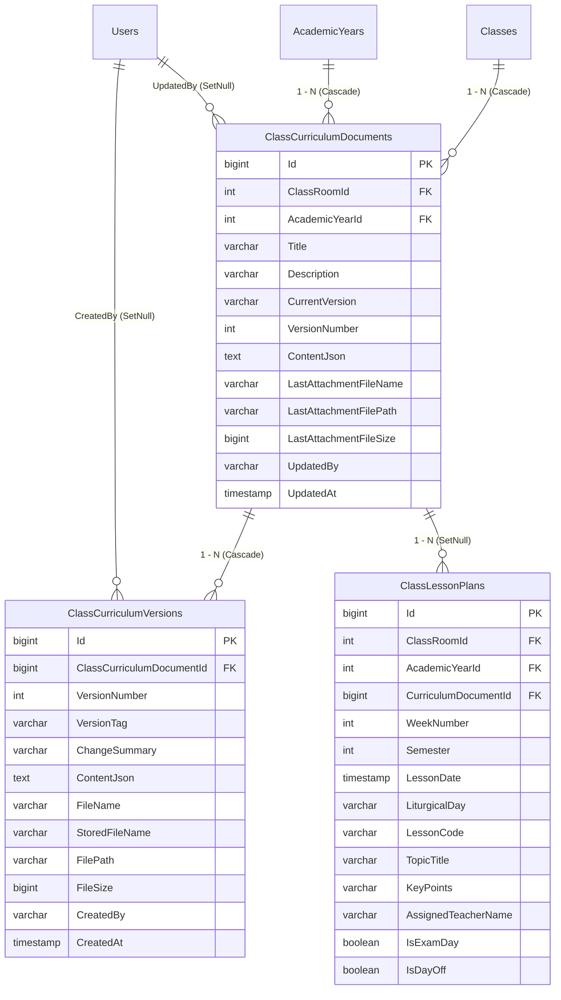

# FEATURE SPECIFICATION: HIỂN THỊ, SỬA TRỰC TIẾP & LƯU KẾ HOẠCH LỚP THEO VERSION NGÀY SỬA (`FEAT-P5-07`)

> **Trạng thái:** COMPLETED  
> **Module:** `LessonPlans` / `Academic`  
> **Mức độ truy cập:** Yêu cầu quyền Staff (`RequireStaff`: Teacher, BranchHead, ExecutiveBoard, SpiritualDirector, Admin)  
> **Bảng Database Tác Động:** `ClassCurriculumDocuments`, `ClassCurriculumVersions`, `ClassLessonPlans`

---

## 1. Mục đích & Bối cảnh Nghiệp vụ

Trong công tác quản lý năm học của Xứ Đoàn Thiếu Nhi Thánh Thể:
- Ban Điều Hành và Giáo lý viên phụ trách lớp cần có kế hoạch phân phối bài học chi tiết từng tuần trong niên khóa (ngày học, bài học, chủ đề, phụ trách, ngày thi, ngày nghỉ lễ).
- Thay vì chỉ tải lên file rời rạc và không sửa được, tính năng **FEAT-P5-07** cho phép:
  1. **Nạp & Phân tích trực tiếp (Parser):** Đọc nội dung từ các file kế hoạch (`.xlsx`, `.docx`, `.csv`, `.md`, `.pdf`) và chuyển đổi tức thì thành bảng bài giảng phân phối chương trình trực quan trên giao diện web.
  2. **Biên tập trực tuyến (Live Editor):** GLV và Trưởng khối có thể thêm tuần, sửa đổi bài học, ngày học, phân công giáo lý viên, đánh dấu ngày kiểm tra/thi hoặc nghỉ lễ ngay trên trình duyệt mà không cần cài đặt phần mềm Office.
  3. **Tự động sinh file đính kèm theo Version & Ngày sửa:** Mỗi lần bấm "Lưu Phiên Bản Mới", hệ thống tự động kết xuất thành file Excel `.xlsx` chuẩn mẫu Giáo xứ gắn hậu tố version và ngày sửa (ví dụ: `KeHoach_TS3A_v2_20261105.xlsx`), lưu trữ an toàn trong `PrivateUploads/curriculums` và bảo toàn tất cả các file của phiên bản cũ.
  4. **Lịch sử phiên bản & Khôi phục (Rollback):** Hỗ trợ xem lại bản chụp chi tiết của từng phiên bản cũ, tải file của ngày sửa bất kỳ hoặc thực hiện Rollback khôi phục về phiên bản trước đó.
  5. **Đồng bộ hai chiều với `ClassLessonPlans`:** Toàn bộ lịch bài giảng được đồng bộ xuống bảng `ClassLessonPlans` để phục vụ trực tiếp cho tính năng Điểm danh QR thời gian thực và theo dõi bài giảng trong ngày.

---

## 2. Thành phần Source Code Tham gia

| Tầng | File Path | Symbol / Thành phần | Vai trò |
|---|---|---|---|
| **Entity** | `Models/Entities/ClassCurriculumDocument.cs` | `ClassCurriculumDocument` | Bảng lưu tài liệu kế hoạch lớp hiện hành, phiên bản, snapshot JSON và liên kết `ClassLessonPlans` |
| **Entity** | `Models/Entities/ClassCurriculumVersion.cs` | `ClassCurriculumVersion` | Bảng lưu lịch sử từng phiên bản ngày sửa, bản chụp tuần học, đường dẫn file `.xlsx` tự động sinh |
| **Entity** | `Models/Entities/ClassLessonPlan.cs` | `ClassLessonPlan` | Bổ sung `CurriculumDocumentId`, `CurriculumDocument`, `WeekNumber`, `Semester` để đồng bộ |
| **DTO** | `Models/DTOs/CurriculumDtos.cs` | `CurriculumItemDto`, `ClassCurriculumDocumentDto`, `ClassCurriculumVersionDto`, `SaveCurriculumRequestDto`, `CurriculumParseResultDto` | DTOs trao đổi dữ liệu JSON giữa Client và Server |
| **ViewModel** | `Models/ViewModels/LessonPlansViewModel.cs` | `LessonPlanWorkspaceViewModel` | ViewModel phục vụ hiển thị toàn diện trang quản lý kế hoạch lớp |
| **Interface** | `Interface/Services/IClassCurriculumService.cs` | `IClassCurriculumService` | Giao diện định nghĩa các nghiệp vụ đọc file, biên tập, xuất Excel, quản lý version và rollback |
| **Service** | `Services/ClassCurriculumService.cs` | `ClassCurriculumService` | Triển khai đọc file đa định dạng (`ClosedXML`, `OpenXML`, `StreamReader`, `PdfPig`), sinh file Excel, đồng bộ DB bằng `IExecutionStrategy` |
| **Controller** | `Controllers/LessonPlansController.cs` | `LessonPlansController` | Các actions `Index`, `ParseCurriculumFile`, `SaveCurriculum`, `RollbackCurriculum`, `GetVersionDetail`, `DownloadCurriculumVersion`, `ExportCurrentCurriculumExcel` |
| **View** | `Views/LessonPlans/Index.cshtml` | Razor View | Giao diện 3 tab: Trình biên tập trực tuyến, Lịch sử phiên bản, Tài liệu giáo án bổ trợ, cùng các modal nạp file và xem chi tiết |

---

## 3. Kiến trúc Cơ sở Dữ liệu & Mối Quan hệ

---

## 4. Đặc tả Chi tiết các Sub-task

### 4.1. TASK-P5-07.1: Thiết kế Database & Đồng bộ Kế hoạch Lớp
- Bảng `ClassCurriculumDocuments` đại diện cho kế hoạch bài học của 1 lớp trong 1 niên khóa. Lưu chuỗi snapshot JSON `ContentJson` của phiên bản hiện hành để nạp nhanh lên web `O(1)`.
- Bảng `ClassCurriculumVersions` lưu từng mốc lịch sử: phiên bản (`v1`, `v2`, ...), snapshot dữ liệu tuần học tại thời điểm đó, tên file tự sinh theo ngày sửa, kích thước, người sửa, ngày giờ sửa.
- Bảng `ClassLessonPlans` liên kết `CurriculumDocumentId` để đảm bảo khi kế hoạch lớp được lưu hoặc rollback, lịch bài học của từng tuần được đồng bộ ngay lập tức.

### 4.2. TASK-P5-07.2: Bộ Đọc (Parser) Đa Định Dạng Nạp File Kế Hoạch
- **Excel (`.xlsx`, `.xls`):** Dùng `ClosedXML`, tự động dò hàng tiêu đề chứa các từ khóa ("tuần", "ngày", "bài", "chủ đề", "trọng tâm", "glv", "ghi chú"), hoặc định vị theo vị trí cột mặc định.
- **Word (`.docx`):** Dùng `DocumentFormat.OpenXml`, trích xuất toàn bộ các bảng (`Table`) trong tài liệu, đọc từng dòng và phân tách các ô thành bài học.
- **CSV (`.csv`):** Đọc luồng văn bản UTF-8, tự động nhận diện dấu phân cách (dấu phẩy `,`, chấm phẩy `;`, tab `\t`, hoặc pipe `|`), xử lý chuỗi trong ngoặc kép.
- **Markdown (`.md`):** Hỗ trợ bảng Markdown chuẩn (`| Tuần | Ngày | Bài | ... |`) và danh sách gạch đầu dòng (`- Tuần 1: Bài 1...`), làm sạch các ký tự định dạng `*`, `_`, `[link]`.
- **PDF (`.pdf`):** Dùng `UglyToad.PdfPig`, trích xuất dòng theo định dạng ngày `dd/MM/yyyy`.

### 4.3. TASK-P5-07.3: Trình Biên tập Trực tuyến & Tự động Sinh File Đính kèm
- Cho phép chỉnh sửa trực tiếp số tuần, ngày học (có nút tự động tính các ngày Chúa Nhật liên tiếp), mùa phụng vụ, số bài, tiêu đề, GLV phụ trách, ghi chú.
- Công tắc chuyển đổi tức thì:
  - **Kiểm tra / Thi:** Đánh dấu buổi thi (tô nền đỏ nhạt).
  - **Nghỉ lễ:** Đánh dấu ngày nghỉ (tô nền vàng nhạt).
- Mỗi lần bấm "Lưu Phiên Bản Mới":
  - Tính toán số phiên bản tiếp theo: `v{N+1}`.
  - Tự động sinh file Excel `.xlsx` với mẫu thiết kế trang trọng: Tiêu đề Giáo xứ, thông tin lớp, bảng biểu đóng khung viền, tô màu phân loại ngày thi/nghỉ, độ rộng cột tự căn chỉnh.
  - Đặt tên file theo chuẩn: `KeHoach_{ClassName}_{versionTag}_{YYYYMMDD}.xlsx`.
  - Lưu file vật lý vào thư mục bảo mật `PrivateUploads/curriculums` (không thể tải công khai trực tiếp từ webroot).
  - Ghi bản ghi phiên bản mới vào `ClassCurriculumVersions`.
  - Đồng bộ nguyên tử (`IExecutionStrategy` + Transaction) sang bảng `ClassLessonPlans`.

### 4.4. TASK-P5-07.4: Giao diện Xem/Sửa Kế hoạch, Lịch sử & Khôi phục (Rollback)
- **Giao diện Tab 1 (Biên tập trực tuyến):** Bảng dữ liệu tương tác mượt mà, hỗ trợ thêm dòng mới, xóa dòng, tự động đánh số thứ tự tuần, thanh thống kê số tuần, số ngày thi, số ngày nghỉ.
- **Giao diện Tab 2 (Lịch sử phiên bản):** Hiển thị danh sách tất cả các phiên bản đã lưu, ngày giờ sửa, người sửa, ghi chú thay đổi, nút tải file Excel tự sinh.
- **Xem chi tiết bản cũ:** Bật modal hiển thị toàn bộ nội dung các tuần học của phiên bản đã chọn.
- **Khôi phục (Rollback):** Khôi phục nội dung của phiên bản cũ vào bảng kế hoạch lớp hiện hành, tạo một phiên bản mới ghi nhận việc rollback (ví dụ: `v3` ghi nhận "Khôi phục từ v1"), bảo toàn toàn bộ lịch sử không bị mất mát.
- **Giao diện Tab 3 (Tài liệu đính kèm khác):** Tích hợp và bảo toàn các file tài liệu PDF/Word truyền thống (`ClassLessonDocuments`) với trình xem PDF inline trong iframe.

---

## 5. Danh mục Endpoints & API

| Endpoint | HTTP Method | Quyền hạn | Mô tả |
|---|---|---|---|
| `/LessonPlans?classRoomId={id}` | `GET` | `RequireStaff` | Xem trang quản lý kế hoạch lớp, danh sách tuần và lịch sử phiên bản |
| `/LessonPlans/ParseCurriculumFile` | `POST` | `Admin, ExecutiveBoard, BranchHead, Teacher` | Nạp file `.xlsx`, `.docx`, `.csv`, `.md`, `.pdf` và chuyển đổi thành JSON danh sách tuần |
| `/LessonPlans/SaveCurriculum` | `POST` | `Admin, ExecutiveBoard, BranchHead, Teacher` | Lưu kế hoạch lớp trực tuyến, sinh file Excel đính kèm và đồng bộ `ClassLessonPlans` |
| `/LessonPlans/GetVersionDetail/{id}` | `GET` | `RequireStaff` | Lấy chi tiết snapshot nội dung tuần học của một phiên bản cũ |
| `/LessonPlans/DownloadCurriculumVersion/{id}` | `GET` | `RequireStaff` | Tải file Excel tự động sinh của một phiên bản ngày sửa |
| `/LessonPlans/ExportCurrentCurriculumExcel` | `GET` | `RequireStaff` | Xuất file Excel bảng kế hoạch lớp phiên bản hiện hành |
| `/LessonPlans/RollbackCurriculum` | `POST` | `Admin, ExecutiveBoard, BranchHead` | Khôi phục kế hoạch lớp về phiên bản ngày sửa cũ |
