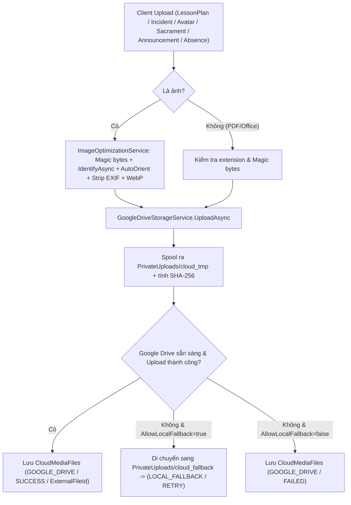

# FEATURE SPECIFICATION: LƯU TRỮ TỆP ĐÁM MÂY GOOGLE DRIVE, TỐI ƯU ẢNH WEBP & BACKJOB NÉN LOG (`FEAT-P5-08`)

> **Trạng thái:** COMPLETED (`Phase-F5.8`, commit `4589783`)  
> **Module:** `CloudStorage` / `Logging` / `LessonPlans` / `Facilities` / `UserAccount` / `Sacraments` / `Notification` / `Attendance`  
> **Mức độ truy cập:** Proxy `/CloudMedia/File/{id}` xác thực Hybrid (`Cookie` + `JWT Bearer`) kèm phân quyền chi tiết theo 7 `Category`; Quản trị `/Admin/Logs/*` yêu cầu `UserRole.Admin`  
> **Bảng Database Tác Động:** `CloudMediaFiles` *(mới)* và các khóa ngoại nullable (`ON DELETE SET NULL`) trên `ClassLessonDocuments`, `ClassCurriculumDocuments`, `ClassCurriculumVersions`, `RoomIncidentReports`, `Students`, `Users` (script pgAdmin: `script/20261123_CloudMediaFiles_GoogleDrive_FeatP5_08.sql`)

---

## 1. Mục đích & Bối cảnh Nghiệp vụ

Khi vận hành ứng dụng trên Docker Alpine container có giới hạn RAM/đĩa cục bộ và vòng đời container stateless:
- Lưu trữ trực tiếp giáo án, ảnh báo hỏng cơ sở vật chất, ảnh đại diện, chứng nhận Bí tích, tệp đính kèm thông báo/đơn xin nghỉ và tệp log Serilog hàng ngày lên đĩa cục bộ khiến dung lượng container phình to và có nguy cơ mất tệp khi tái tạo container.
- Tính năng **FEAT-P5-08** (gồm 9 sub-tasks `TASK-P5-08.0` ➔ `TASK-P5-08.8`) giải quyết triệt để qua 5 trụ cột:
  1. **Kho lưu trữ hợp nhất trên Google Drive (`CloudMediaFiles`):** Tải tệp bằng Service Account qua Resumable Upload hỗ trợ My Drive và Shared Drive (`SupportsAllDrives = true`), lưu vết `Sha256Hash`, `ExternalFileId`, `DriveFolderPath`, và tự động rơi về `LOCAL_FALLBACK` (`PrivateUploads/cloud_fallback`) khi Drive/mạng lỗi để không làm gián đoạn nghiệp vụ.
  2. **Auth Proxy streaming bảo mật (`/CloudMedia/File/{id}`):** Không mở quyền truy cập public trên Google Drive; mọi yêu cầu xem/tải tệp đều đi qua `CloudMediaController` kiểm tra xác thực và ma trận phân quyền theo từng `Category` và phạm vi lớp/khối.
  3. **Tối ưu hình ảnh WebP thuần managed trên Alpine:** Sử dụng `SixLabors.ImageSharp` `3.1.12` kiểm tra magic bytes nghiêm ngặt, giới hạn kích thước ảnh đầu vào trước khi giải mã, `AutoOrient()`, xóa metadata EXIF/IPTC/XMP và nén sang WebP lossy.
  4. **Backjob nén GZip & Upload Log tự động:** `DriveLogUploadBackgroundService` chạy theo lịch Cron múi giờ Việt Nam (`0 2 * * *`), nén `.log` cũ bằng `GZipStream` streaming, tải lên Drive (`AllowLocalFallback = false`), chỉ xóa file `.log` gốc sau khi đã xác thực `ExternalFileId`.
  5. **Bảng điều khiển Admin & Công cụ Di chuyển Dữ liệu cũ:** Giao diện `/Admin/Logs` cho phép Admin theo dõi sức khỏe Drive, chạy upload log thủ công, đồng bộ lại toàn bộ `LOCAL_FALLBACK` và chạy `LocalMediaMigrationService` (`Dry-Run` hoặc di chuyển thật kèm tùy chọn xóa file gốc sau xác thực).

---

## 2. Thành phần Source Code Tham gia

| Tầng | File Path | Symbol / Thành phần | Vai trò |
|---|---|---|---|
| **Config/Infra** | `ManagerStudentCaltholic.csproj` | `Google.Apis.Drive.v3` (`1.69.0.3769`), `Google.Apis.Auth` (`1.78.0`), `SixLabors.ImageSharp` (`3.1.12`) | SDK Google Drive v3, Service Account Auth và xử lý ảnh thuần managed |
| **Config/Infra** | `Program.cs` | `KestrelServerOptions`, `FormOptions` | Nâng giới hạn upload `MaxRequestBodySize` và `MultipartBodyLengthLimit` lên `30 MB` (`30 * 1024 * 1024`) |
| **Config/Infra** | `Dockerfile` | `/app/PrivateUploads/{cloud_fallback,cloud_tmp,tmp_logs}` | Tạo sẵn thư mục ghi tạm và fallback cho non-root user `$APP_UID` trên Alpine |
| **Config/Infra** | `appsettings.json` | Sections `"GoogleDrive"`, `"DriveLogUpload"` | Cấu hình giới hạn dung lượng, chunk size, đường dẫn key/fallback, lịch cron backjob log (không chứa secret) |
| **Config/Infra** | `Extensions/ServiceCollectionExtensions.cs` | `AddApplicationServices(IConfiguration)` | Bind `GoogleDriveOptions`, `DriveLogUploadOptions` và đăng ký DI Services + `DriveLogUploadBackgroundService` |
| **Options** | `Models/Options/GoogleDriveOptions.cs` | `GoogleDriveOptions` | Tùy chọn cấu hình Google Drive, giới hạn byte theo loại tệp, chunk size và số lần retry |
| **Options** | `Models/Options/DriveLogUploadOptions.cs` | `DriveLogUploadOptions` | Tùy chọn cấu hình Backjob nén/upload log Serilog lên Drive |
| **Entity** | `Models/Entities/CloudMediaFile.cs` | `CloudMediaFile`, `CloudMediaCategory`, `CloudStorageProvider`, `CloudSyncStatus` | Thực thể `ISoftDelete` ánh xạ bảng `CloudMediaFiles` và các hằng số chuẩn hóa |
| **Entity** | `Models/Entities/ClassLessonDocument.cs`, `ClassCurriculumDocument.cs`, `ClassCurriculumVersion.cs`, `RoomIncidentReport.cs`, `Student.cs`, `User.cs` | `CloudFileId`, `CloudImageFileId`, `AvatarCloudFileId` | Khóa ngoại nullable (`DeleteBehavior.SetNull`) trỏ tới `CloudMediaFiles` |
| **Database** | `Data/ParishDbContext.cs` & `script/20261123_CloudMediaFiles_GoogleDrive_FeatP5_08.sql` | `DbSet<CloudMediaFile> CloudMediaFiles` | Cấu hình bảng, Global Query Filter `!e.IsDeleted`, 5 index và 6 FK `ON DELETE SET NULL` |
| **DTO** | `Models/DTOs/CloudMediaDtos.cs` | `CloudUploadRequest`, `CloudDownloadResult`, `CloudMediaSummaryDto`, `CloudStorageHealthDto`, `DriveLogUploadRunResultDto`, `LocalMigrationReportDto` | DTO trao đổi upload/download, health check, báo cáo log backjob và migration |
| **Interface** | `Interface/Services/IGoogleDriveStorageService.cs` | `IGoogleDriveStorageService` | Hợp đồng upload, download streaming, delete, tạo folder, retry fallback, health & entity mapping |
| **Interface** | `Interface/Services/IImageOptimizationService.cs` | `IImageOptimizationService` | Hợp đồng kiểm tra phần mở rộng ảnh và tối ưu sang WebP |
| **Interface** | `Interface/Services/IDriveLogUploadService.cs` | `IDriveLogUploadService` | Hợp đồng chạy chu kỳ upload log và lấy lịch sử upload log |
| **Interface** | `Interface/Services/ILocalMediaMigrationService.cs` | `ILocalMediaMigrationService` | Hợp đồng chạy di chuyển dữ liệu cục bộ cũ lên Drive (`DryRun` / thật) |
| **Service** | `Services/GoogleDriveStorageService.cs` | `GoogleDriveStorageService` | Quản lý `DriveService` theo mtime key, cache thư mục 30p, Resumable Upload, `LOCAL_FALLBACK`, download/delete |
| **Service** | `Services/ImageOptimizationService.cs` | `ImageOptimizationService` | Kiểm tra magic bytes + `Image.IdentifyAsync`, resize, xóa EXIF/IPTC/XMP, mã hóa WebP |
| **Service** | `Services/DriveLogUploadService.cs` | `DriveLogUploadService` | Quét `logs/*.log`, bảo vệ log đang ghi, nén GZip streaming, upload lên Drive và dọn log cũ |
| **Worker** | `Services/DriveLogUploadBackgroundService.cs` | `DriveLogUploadBackgroundService`, `CronScheduleCalculator` | `BackgroundService` chạy định kỳ theo Cron 5 trường múi giờ Việt Nam hoặc `IntervalMinutes` |
| **Service** | `Services/LocalMediaMigrationService.cs` | `LocalMediaMigrationService` | Di chuyển 4 bước (`Step A..D`) fallback, giáo án, phiên bản kế hoạch lớp và tệp mồ côi |
| **Service** | `Services/ClassCurriculumService.cs`, `ProfileHistoryService.cs` | `SaveCurriculumAsync`, `GetVersionFileAsync`, `BuildCompositeViewModelAsync` | Tích hợp lưu/tải Excel phiên bản qua Drive và ưu tiên URL avatar `/CloudMedia/File/{id}` |
| **Controller** | `Controllers/CloudMediaController.cs` | `CloudMediaController` (`File`) | Auth Proxy stream/tải tệp theo phân quyền 7 loại danh mục |
| **Controller** | `Controllers/LogsController.cs` | `Index`, `TriggerDriveLogUpload`, `RetryFallbackSync`, `RunLocalMediaMigration` | Trang Admin giám sát Drive Health, kích hoạt backjob log, retry fallback và migration |
| **Controller** | `Controllers/LessonPlansController.cs`, `FacilitiesController.cs`, `AccountController.cs`, `StudentsController.cs`, `SacramentsController.cs`, `AnnouncementsController.cs`, `AbsenceController.cs` | Upload / Download / Delete tích hợp CloudMedia | Tích hợp trực tiếp luồng upload/xem/xóa qua `IGoogleDriveStorageService` và `IImageOptimizationService` |
| **View** | `Views/Logs/Index.cshtml`, `LessonPlans/Index.cshtml`, `Facilities/Index.cshtml`, `Account/Profile.cshtml`, `Students/{Details,PrintBadges}.cshtml`, `Sacraments/Index.cshtml`, `Announcements/Index.cshtml`, `Absence/Manage.cshtml`, `Lookup/Result.cshtml` | Giao diện người dùng & Admin | Form upload, badge trạng thái Drive/Fallback, link `/CloudMedia/File/{id}`, bảng điều khiển Admin |

---

## 3. Đặc tả Chi tiết 9 Sub-tasks (`TASK-P5-08.0` ➔ `TASK-P5-08.8`)

### 3.1. `TASK-P5-08.0`: Hạ tầng lõi Google Drive Storage & Auth Proxy
- **Cấu hình `GoogleDriveOptions` (`appsettings.json` section `"GoogleDrive"`):**
  - `Enabled` (`true`), `ServiceAccountKeyPath` (`"/app/secrets/google-service-account.json"`), `RootFolderId` (`""`), `RootFolderName` (`"QLGL_Storage_Root"`), `SharedDriveId` (`""`), `LocalFallbackRoot` (`"PrivateUploads/cloud_fallback"`).
  - Giới hạn mặc định: `MaxIncidentImageBytes = 15728640` (15 MB), `MaxLessonPlanBytes = 26214400` (25 MB), `MaxDocumentBytes = 10485760` (10 MB), `MaxAvatarBytes = 5242880` (5 MB).
  - Tham số truyền tải: `UploadChunkSizeBytes = 2097152` (2 MB), `MaxRetryAttempts = 3`.
- **Thứ tự phân giải thư mục gốc trên Google Drive (`EnsureFolderPathInternalAsync`):**
  1. Nếu truyền `ExplicitParentFolderId` trên `CloudUploadRequest` ➔ dùng làm thư mục cha trực tiếp.
  2. Ngược lại nếu có `RootFolderId` ➔ dùng `RootFolderId` làm gốc rồi tạo các thư mục con `FolderSegments`.
  3. Ngược lại nếu có `SharedDriveId` ➔ xuất phát từ `SharedDriveId` (kèm `RootFolderName` nếu có) rồi tạo các thư mục con.
  4. Ngược lại nếu có `RootFolderName` ➔ tìm/tạo thư mục gốc trên My Drive của Service Account; nếu cả 4 đều rỗng ➔ trả `null` và kích hoạt `LOCAL_FALLBACK` hoặc `FAILED`.
  5. Dùng `IMemoryCache` (TTL 30 phút) kết hợp `ConcurrentDictionary<string, SemaphoreSlim>` để chống race condition tạo trùng thư mục; hỗ trợ Shared Drive qua `SupportsAllDrives = true`, `IncludeItemsFromAllDrives = true`, `Corpora = "drive"`, `DriveId`.
- **`GoogleDriveStorageService`:**
  - Cache `DriveService` singleton theo `(ServiceAccountKeyPath, LastWriteTimeUtc)` để tự nạp lại nếu key đổi trên đĩa.
  - Upload dùng `Files.Create(...).UploadAsync` (Resumable Upload với chunk size căn chỉnh bội số của `256 KB` trong khoảng `256 KB..2 MB`) và retry tối đa `MaxRetryAttempts` lần với exponential backoff (`500ms * 2^(attempt-1)`).
  - `TryResolveContainedFallbackPath` và `EnsureContainedPath` chặn tuyệt đối Path Traversal khi đọc/xóa tệp trong `PrivateUploads/cloud_fallback`.
- **`ImageOptimizationService`:**
  - Hỗ trợ phần mở rộng `.jpg`, `.jpeg`, `.png`, `.webp`, `.gif`.
  - Xác thực **magic bytes** header thực tế (JPEG `FF D8 FF`, PNG `89 50 4E 47`, GIF `47 49 46 38`, WebP `RIFF....WEBP`).
  - Gọi `Image.IdentifyAsync` trước khi decode toàn bộ ảnh, từ chối nếu chiều rộng/cao `<= 0`, vượt quá `10000x10000` hoặc tổng pixel `> 50,000,000`.
  - Gọi `AutoOrient()`, `Resize(ResizeMode.Max)`, xóa `ExifProfile`, `IptcProfile`, `XmpProfile`, mã hóa `WebpEncoder` (`WebpFileFormatType.Lossy`).

### 3.2. `TASK-P5-08.1`: Giáo án & Kế hoạch Lớp (`LessonPlans`)
- **Tài liệu đính kèm truyền thống (`LessonPlansController.UploadDocument`, `DownloadDocument`, `DeleteDocument`):**
  - Chấp nhận `.pdf`, `.docx`, `.doc`, `.xlsx`, `.xls` (kiểm tra magic bytes `%PDF`, `PK\x03\x04`, OLE `D0 CF 11 E0 A1 B1 1A E1`), giới hạn `MaxLessonPlanBytes` (25 MB).
  - Thực thi trong `CreateExecutionStrategy()` + transaction: tạo `ClassLessonDocument`, upload lên `{AcademicYear}/LessonPlans` với `Category = LESSON_PLAN`, gán `doc.CloudFileId = media.Id` và `doc.FilePath = "/LessonPlans/DownloadDocument/{doc.Id}"`.
  - `DownloadDocument` ưu tiên tải từ `_storageService.DownloadAsync(doc.CloudFileId.Value)`, fallback về tệp cục bộ cũ trong `PrivateUploads/lesson_plans` hoặc `wwwroot/uploads/lesson_plans`.
  - `DeleteDocument` xóa bản ghi `ClassLessonDocuments`, gọi `_storageService.DeleteAsync(cloudFileId)` (xóa vật lý trên Drive + xóa mềm `CloudMediaFiles`) và dọn file cục bộ cũ nếu còn.
- **Phiên bản Kế hoạch lớp (`ClassCurriculumService.SaveCurriculumAsync`, `GetVersionFileAsync`):**
  - Sinh workbook Excel trực tiếp vào `MemoryStream` (`GenerateExcelToMemoryStream`) không ghi trùng file cục bộ, upload lên `{AcademicYear}/LessonPlans` gắn `EntityName = "ClassCurriculumVersion"`, gán `CloudFileId` cho cả `ClassCurriculumVersion` và `ClassCurriculumDocument`.
  - `GetVersionFileAsync` ưu tiên tải từ `CloudMediaFiles` (`ver.CloudFileId`), fallback sang `PrivateUploads/curriculums`, và nếu cả hai đều thiếu thì **tái tạo tức thì** từ snapshot `ver.ContentJson`.

### 3.3. `TASK-P5-08.2`: Ảnh Báo hỏng Cơ sở Vật chất (`Facilities`)
- `FacilitiesController.ReportIncident` nhận `IFormFile? incidentImage`, giới hạn `MaxIncidentImageBytes` (15 MB), kiểm tra định dạng ảnh hỗ trợ.
- Nén ảnh qua `OptimizeToWebpAsync(maxWidth: 1600, maxHeight: 1600, quality: 78)`.
- Trong transaction (`CreateExecutionStrategy`): lưu `RoomIncidentReport`, upload ảnh lên `{AcademicYear}/Incidents` (`Category = INCIDENT_IMAGE`, `EntityName = "RoomIncidentReport"`, `EntityId = report.Id`), cập nhật `report.CloudImageFileId = media.Id`.
- `FacilitiesController.Index` nạp `.Include(r => r.CloudImageFile)` và `Views/Facilities/Index.cshtml` hiển thị ảnh qua `/CloudMedia/File/{CloudImageFileId}`.

### 3.4. `TASK-P5-08.3`: Ảnh Đại diện & Chứng nhận Bí tích (`Account`, `Students`, `Sacraments`)
- **Ảnh đại diện Người dùng (`AccountController.UploadAvatar`):**
  - Yêu cầu `[Authorize]`; cho phép người dùng tự đổi ảnh hoặc `Admin`/`ExecutiveBoard` đổi cho `userId` khác (ngược lại trả `Forbid()`).
  - Giới hạn `MaxAvatarBytes` (5 MB), nén WebP `512x512` quality `82`, upload vào `Students_Avatars` (`Category = AVATAR`, `EntityName = "User"`).
  - Cập nhật `user.AvatarCloudFileId = media.Id`, `user.AvatarUrl = "/CloudMedia/File/{media.Id}"`, đồng thời đồng bộ `AvatarCloudFileId` sang `Student` liên kết (`LinkedStudentId ?? StudentId`); chỉ gọi `_storageService.DeleteAsync(oldId)` nếu không còn `Student`/`User` khác tham chiếu.
- **Ảnh đại diện Thiếu nhi (`StudentsController.UploadAvatar`):**
  - Yêu cầu quyền truy cập học sinh (`CanAccessStudentAsync`); nén WebP `512x512` quality `82`, upload vào `Students_Avatars` (`EntityName = "Student"`).
  - Cập nhật `student.AvatarCloudFileId = media.Id`, dọn ảnh cũ nếu không còn User tham chiếu, và xóa cache `staff_lookup:student_360:{studentId}`.
  - `ProfileHistoryService` và `StudentsController.PrintBadges` ưu tiên `/CloudMedia/File/{AvatarCloudFileId}` với fallback từ `User` liên kết sang `Student` và ngược lại.
- **Chứng nhận Bí tích (`SacramentsController.UploadCertificate`, `DeleteCertificate`, `GetRecords`):**
  - Chỉ `Admin`, `SpiritualDirector`, `ExecutiveBoard`, `BranchHead` (đúng phạm vi học sinh) được upload/xóa.
  - Chấp nhận `.pdf` (kiểm tra magic bytes `%PDF`) hoặc `.jpg/.jpeg/.png/.webp` (nén WebP `1800x1800` quality `82`), giới hạn `MaxDocumentBytes` (10 MB), lưu vào `Sacraments_Docs` (`Category = SACRAMENT_DOC`, `EntityName = "StudentSacramentRecord"`, `EntityId = record.Id`).
  - `GetRecords` dùng `GetMediaMapForEntitiesAsync` nạp danh sách `Certificates` cho từng mốc Bí tích trên timeline.

### 3.5. `TASK-P5-08.4`: Đính kèm Bảng tin & Đơn xin phép nghỉ học (`Announcements`, `Absence`)
- **Bảng tin (`AnnouncementsController.Index`, `Create`, `Delete`):**
  - Cho phép đính kèm tối đa `5` tệp mỗi thông báo (`MaxAnnouncementAttachments = 5`), mỗi tệp tối đa `MaxDocumentBytes` (10 MB).
  - Hỗ trợ tài liệu (`.pdf`, `.docx`, `.doc`, `.xlsx`, `.xls` có kiểm tra magic bytes) và hình ảnh (`.jpg`, `.jpeg`, `.png`, `.webp` nén WebP `1600x1600` quality `78`).
  - Upload lên `{AcademicYear}/Announcements` (`Category = ANNOUNCEMENT_DOC`, `EntityName = "Announcement"`). Khi xóa bài thông báo (`Delete`), controller xóa đồng thời toàn bộ tệp đính kèm qua `_storageService.DeleteAsync`.
- **Đơn xin phép nghỉ học (`AbsenceController.SubmitRequestWithFile`, `Manage`):**
  - Endpoint `[AllowAnonymous]`, `[ValidateAntiForgeryToken]`, `[EnableRateLimiting(SecurityExtensions.PolicyPublicLookup)]` phục vụ phụ huynh từ trang `/TraCuu` (`Views/Lookup/Result.cshtml`). Giữ nguyên `SubmitRequest` JSON để tương thích ngược.
  - Xác thực `StudentCode`, `DateOfBirth`, và khớp toàn bộ chữ số `ParentPhone` với hồ sơ học sinh đang hoạt động.
  - Tệp minh chứng tùy chọn tối đa `MaxDocumentBytes` (10 MB): `.pdf` (kiểm tra `%PDF`) hoặc ảnh `.jpg/.jpeg/.png/.webp` (nén WebP `1600x1600` quality `78`), lưu vào `{AcademicYear}/AbsenceRequests` (`Category = ABSENCE_DOC`, `EntityName = "AbsenceRequest"`).
  - `AbsenceController.Manage` nạp `ViewBag.AbsenceAttachments` qua `GetMediaMapForEntitiesAsync` để GLV/BĐH mở xem qua `/CloudMedia/File/{id}`.

### 3.6. `TASK-P5-08.5`: Cấu hình & Dịch vụ Backjob Nén GZip + Upload Log (`DriveLogUploadService`)
- Cấu hình qua `DriveLogUploadOptions` (`appsettings.json` section `"DriveLogUpload"`):
  - `Enabled = true`, `CronExpression = "0 2 * * *"`, `IntervalMinutes = 0`, `LocalLogsPath = "logs"`, `LocalRetentionDays = 1`, `LogsFolderId = ""`, `DeleteLocalAfterVerifiedUpload = true`, `MaxRetriesPerFile = 3`, `RetryDelaySeconds = 10`, `UploadBufferSizeBytes = 65536`.
- Cơ chế bảo vệ & thực thi trong `DriveLogUploadService.RunUploadCycleAsync`:
  - Khóa đồng thời bằng `SemaphoreSlim(1, 1)` (`RunLock.WaitAsync(0, ct)`).
  - `IsProtectedActiveLogFile` bảo vệ tệp `.log` của ngày hôm nay theo múi giờ Việt Nam (`yyyyMMdd`) và các tệp nằm trong ngưỡng `LocalRetentionDays` (`cutoffDate = todayVn.AddDays(-(retentionDays - 1))`) theo cả ngày trong tên file lẫn `LastWriteTimeUtc`.
  - Bỏ qua các tệp đã có bản ghi `Category = SYSTEM_LOG`, `StorageProvider = GOOGLE_DRIVE`, `SyncStatus = SUCCESS` và `ExternalFileId != null`.
  - Khi trigger `SCHEDULED`, bỏ qua các tệp đã chạm ngưỡng `MaxRetriesPerFile` ở trạng thái `FAILED`; khi trigger thủ công `MANUAL:*`, cho phép thử lại.
  - Nén GZip streaming bằng `GZipStream` (`CompressionLevel.Optimal`) với buffer thuê từ `ArrayPool<byte>.Shared` (`Clamp(UploadBufferSizeBytes, 4096, 1048576)`) ra thư mục tạm `PrivateUploads/tmp_logs`, upload với **`AllowLocalFallback = false`** vào `System_Logs/{yyyy-MM}` (hoặc `{yyyy-MM}` nếu cấu hình `LogsFolderId`).
  - Xóa mềm các bản ghi `FAILED`/`RETRY` cũ của cùng tệp sau khi upload lại để chỉ giữ 1 bản ghi active; **chỉ xóa file `.log` gốc** khi `DeleteLocalAfterVerifiedUpload == true`, đã xác thực `ExternalFileId` từ Drive, và file không thuộc nhóm active.

### 3.7. `TASK-P5-08.6`: Background Worker chạy lịch Cron (`DriveLogUploadBackgroundService`)
- Đăng ký qua `services.AddHostedService<DriveLogUploadBackgroundService>()` trong `ServiceCollectionExtensions.AddApplicationServices(IConfiguration)`.
- Hỗ trợ 2 chế độ lịch:
  - Nếu `IntervalMinutes > 0`: chạy lặp mỗi `IntervalMinutes` phút.
  - Mặc định (`IntervalMinutes <= 0`): dùng `CronScheduleCalculator` tự phân tích biểu thức Cron 5 trường (`phút giờ ngày tháng thứ`, hỗ trợ `*`, `,`, `-`, `/`, chuẩn hóa Chủ Nhật `0`/`7`) theo múi giờ Việt Nam (`SE Asia Standard Time` trên Windows / `Asia/Ho_Chi_Minh` trên Linux/Alpine, fallback custom UTC+7). Nếu Cron cấu hình không hợp lệ, tự động rơi về `"0 2 * * *"`.
- Dùng `DelayUntilUtcAsync` chia nhỏ sleep tối đa 12 giờ/lần tránh giới hạn `Task.Delay` dài ngày; khi gặp ngoại lệ bất ngờ trong chu kỳ, log lỗi và delay 1 phút rồi tiếp tục vòng lặp.

### 3.8. `TASK-P5-08.7`: Giao diện & API Quản trị Drive Storage trên `/Admin/Logs`
- `LogsController` (`[Authorize(Roles = UserRole.Admin)]`) bổ sung `PopulateDriveStorageSectionAsync` nạp `CloudStorageHealth`, `DriveLogUploads` (30 bản ghi `SYSTEM_LOG` gần nhất), `DriveLogCronSchedule` và `DriveLogEnabled` vào `SystemLogsViewModel`.
- `Views/Logs/Index.cshtml` hiển thị card **Lưu trữ Google Drive, Backjob Log & Đồng bộ Dữ liệu cũ (FEAT-P5-08)** với các badge trạng thái (`IsDriveEnabled`, `IsServiceAccountKeyFound`, `IsRootFolderConfigured`, tổng file, đã lên Drive, chờ fallback, lỗi, lịch Cron), 4 nút thao tác (`Chạy Upload Log Ngay`, `Đồng bộ lại File Fallback`, `Quét Kiểm Tra (Dry-Run)`, `Di Chuyển Dữ Liệu Cũ lên Drive` kèm checkbox cảnh báo xóa file gốc), vùng log phản hồi và bảng lịch sử 30 lượt nén/upload log gần nhất có link tải qua `/CloudMedia/File/{id}?download=true`.
- Endpoints `POST` có `[ValidateAntiForgeryToken]`:
  - `/Admin/Logs/TriggerDriveLogUpload`
  - `/Admin/Logs/RetryFallbackSync`
  - `/Admin/Logs/RunLocalMediaMigration`

### 3.9. `TASK-P5-08.8`: Công cụ Di chuyển Dữ liệu Cục bộ cũ (`LocalMediaMigrationService`)
- Bảo vệ chống chạy trùng bằng `SemaphoreSlim(1, 1)` (`MigrationLock.WaitAsync(0, ct)`).
- Thực thi tuần tự 4 bước (`Step A` ➔ `Step D`), hỗ trợ `dryRun` (mặc định `true`) và `deleteLocalAfterVerified` (mặc định `false`):
  - **Step A:** Gọi `RetryAllPendingFallbackFilesAsync` để đồng bộ lại toàn bộ bản ghi `LOCAL_FALLBACK` (`RETRY` / `PENDING_SYNC`) lên Google Drive và cộng `FreedBytes`.
  - **Step B:** Quét `ClassLessonDocuments` có `CloudFileId == null`, tìm tệp trong `PrivateUploads/lesson_plans` hoặc `wwwroot/uploads/lesson_plans` (có containment check chống traversal), upload với `AllowLocalFallback = false` vào `{YearName}/LessonPlans`, cập nhật `doc.CloudFileId` và chuẩn hóa `doc.FilePath` từ `/uploads/...` sang `/LessonPlans/DownloadDocument/{doc.Id}`.
  - **Step C:** Quét `ClassCurriculumVersions` có `CloudFileId == null`, tìm tệp trong `PrivateUploads/curriculums`, upload vào `{YearName}/LessonPlans`, cập nhật `ver.CloudFileId` và đồng bộ `CurriculumDocument.CloudFileId` nếu là phiên bản hiện hành.
  - **Step D:** Quét các tệp mồ côi trên đĩa trong `wwwroot/uploads/lesson_plans` không còn được tham chiếu bởi bất kỳ `ClassLessonDocuments.StoredFileName` nào (kể cả đã xóa mềm via `IgnoreQueryFilters()`), kiểm tra chưa migrate trước đó (`EntityName = "LegacyOrphan"`), upload lên `Legacy_Orphans/lesson_plans`.
- Ở các bước B, C, D: xóa mềm bản ghi lỗi cũ cùng thực thể (`CleanupSupersededFailedMediaAsync`) khi upload thành công và chỉ xóa tệp gốc trên đĩa khi `deleteLocalAfterVerified == true` và `IsVerifiedDriveUpload(media) == true`.

---

## 4. Ma trận Phân quyền Auth Proxy (`/CloudMedia/File/{id}`)

`CloudMediaController.File` yêu cầu `[Authorize(AuthenticationSchemes = "Cookies,Bearer")]`, kiểm tra `NameIdentifier`, nạp metadata từ `CloudMediaFiles` (AsNoTracking) và đánh giá quyền truy cập theo từng `Category` trong `CanAccessMediaAsync`:

| Category (`CloudMediaCategory`) | `Admin` | `SpiritualDirector` / `ExecutiveBoard` | `BranchHead` | `Teacher` / `ProbationaryTeacher` | Tài khoản ngoài Staff (nếu đăng nhập) |
|---|---|---|---|---|---|
| `SYSTEM_LOG` | **Cho phép** | Từ chối (`403`) | Từ chối (`403`) | Từ chối (`403`) | Từ chối (`403`) |
| `LESSON_PLAN` | **Cho phép** | **Cho phép** | Đúng khối `ManagedGradeLevel` hoặc lớp được phân công | Đúng lớp được phân công trong `ClassTeachers` | Từ chối (`403`) |
| `INCIDENT_IMAGE` | **Cho phép** | **Cho phép** | Chỉ người báo cáo (`RoomIncidentReport.ReporterUserId == currentUserId`) | Chỉ người báo cáo (`ReporterUserId == currentUserId`) | Từ chối (`403`) |
| `AVATAR` (`EntityName = User`) | **Cho phép** | **Cho phép** | **Cho phép** | **Cho phép** | Chỉ chính chủ (`EntityId == currentUserId`) |
| `AVATAR` (`EntityName = Student`) | **Cho phép** | **Cho phép** | **Cho phép** | **Cho phép** | Từ chối (`403`) |
| `SACRAMENT_DOC` | **Cho phép** | **Cho phép** | Học sinh học lớp thuộc `ManagedGradeLevel` (niên khóa hiện hành) hoặc lớp phụ trách | Học sinh nằm trong lớp được phân công `ClassTeachers` | Từ chối (`403`) |
| `ANNOUNCEMENT_DOC` | **Cho phép** | **Cho phép** | `ALL`/`PARISH`: Cho phép; `GRADE`: đúng khối phụ trách/dạy; `CLASS`: đúng khối hoặc lớp phụ trách | `ALL`/`PARISH`: Cho phép; `GRADE`: có dạy lớp trong khối; `CLASS`: đúng lớp phụ trách | Từ chối (`403`) |
| `ABSENCE_DOC` | **Cho phép** | **Cho phép** | Thuộc lớp/học sinh trong khối `ManagedGradeLevel` hoặc lớp phụ trách | Thuộc lớp/học sinh trong lớp được phân công `ClassTeachers` | Từ chối (`403`) |

**HTTP Response Headers của Proxy:**
- Luôn gắn `X-Content-Type-Options: nosniff`.
- `Cache-Control`:
  - `SYSTEM_LOG`, `SACRAMENT_DOC`: `no-store, no-cache, must-revalidate`
  - `INCIDENT_IMAGE`, `AVATAR`: `private, max-age=300`
  - Các loại còn lại (`LESSON_PLAN`, `ANNOUNCEMENT_DOC`, `ABSENCE_DOC`): `private, no-cache`
- Chỉ trả `Content-Disposition: inline` khi `!download` và `ContentType` thuộc danh sách an toàn (`image/webp`, `image/jpeg`, `image/png`, `image/gif`, `application/pdf`); mọi trường hợp khác trả `File(..., contentType, safeFileName)` dạng `attachment` để tránh Stored XSS qua file HTML/SVG.

---

## 5. Ràng buộc Tài nguyên, Streaming & Khả năng Chịu lỗi (`LOCAL_FALLBACK`)

1. **Giới hạn HTTP Request (`Program.cs`):** `KestrelServerOptions.Limits.MaxRequestBodySize = 30 MB`, `FormOptions.MultipartBodyLengthLimit = 30 MB`, `KeepAliveTimeout = 2m`, `RequestHeadersTimeout = 30s`.
2. **Spooling upload không giữ toàn bộ file trên RAM (`GoogleDriveStorageService.SpoolToTempFileAndComputeSha256Async`):** Đọc luồng vào tệp tạm `PrivateUploads/cloud_tmp/{Guid}.tmp` qua buffer thuê từ `ArrayPool<byte>.Shared` (`81,920 bytes`) đồng thời tính `IncrementalHash` SHA-256 trong một lượt đọc, sau đó xóa tệp tạm trong `finally` (hoặc `File.Move` sang `cloud_fallback` nếu kích hoạt fallback).
3. **Resumable Upload Chunking:** `UploadChunkSizeBytes` được kẹp trong `[256 KB, 2 MB]` và căn chỉnh bội số của `ResumableUpload.MinimumChunkSize` (`256 KB`) để kiểm soát bộ nhớ đệm mỗi request trên Alpine.
4. **Download Threshold (`2 MB`):** Tệp tải từ Drive được tải vào tệp tạm có `FileOptions.DeleteOnClose`. Nếu `<= 2 MB`, sao chép sang `MemoryStream` và đóng tệp tạm ngay; nếu `> 2 MB`, stream trực tiếp từ `FileStream` (`DeleteOnClose`) để hệ điều hành tự xóa file tạm khi ASP.NET Core stream xong.
5. **Giới hạn giải mã ảnh (`ImageOptimizationService`):**
   - Magic-byte whitelist + `Image.IdentifyAsync` chặn ảnh quá khổ (`> 10,000` px mỗi cạnh hoặc `> 50,000,000` tổng pixel) trước khi cấp phát pixel buffer.
   - Kết quả WebP `<= 2 MB` trả về `MemoryStream`; `> 2 MB` giữ `FileStream` với `FileOptions.DeleteOnClose` trong `PrivateUploads/cloud_tmp`.
6. **Cơ chế `LOCAL_FALLBACK`:**
   - Khi Google Drive tắt, thiếu key JSON, thiếu Root/SharedDrive hoặc upload thất bại sau `MaxRetryAttempts` lần: nếu `AllowLocalFallback = true`, tệp được di chuyển vào `PrivateUploads/cloud_fallback/{Category}/{StoredFileName}` và ghi bản ghi DB `StorageProvider = LOCAL_FALLBACK`, `SyncStatus = RETRY`.
   - `DownloadAsync` đọc trực tiếp từ đường dẫn fallback (kiểm tra containment chống path traversal); `RetrySyncFallbackFileAsync` / `RetryAllPendingFallbackFilesAsync` cho phép đẩy bù lên Google Drive và xóa bản cục bộ sau khi thành công.
   - Riêng `DriveLogUploadService` và `LocalMediaMigrationService` đặt `AllowLocalFallback = false` để tránh nhân đôi tệp log/file cục bộ đang tồn tại sẵn trên đĩa.

---

## 6. Luồng Xử lý Chính

---

## 7. Danh mục Endpoints Liên quan

| Endpoint | Method | Quyền hạn | Mô tả |
|---|---|---|---|
| `/CloudMedia/File/{id:long}?download={bool}` | `GET` | `Cookies,Bearer` + Matrix theo Category | Auth Proxy stream/tải tệp từ Google Drive hoặc `LOCAL_FALLBACK` |
| `/Admin/Logs/TriggerDriveLogUpload` | `POST` | `Admin` | Kích hoạt thủ công nén & upload các file `.log` cũ lên Drive |
| `/Admin/Logs/RetryFallbackSync` | `POST` | `Admin` | Đồng bộ lại toàn bộ bản ghi `LOCAL_FALLBACK` (`RETRY`/`PENDING_SYNC`) |
| `/Admin/Logs/RunLocalMediaMigration` | `POST` | `Admin` | Chạy `Dry-Run` hoặc di chuyển thật tệp cục bộ cũ (Step A..D) |
| `/LessonPlans/UploadDocument` | `POST` | `Admin, ExecutiveBoard, BranchHead, Teacher` | Tải giáo án (tối đa 25 MB) lên Drive và gắn `CloudFileId` |
| `/LessonPlans/DownloadDocument/{id:long}` | `GET` | `RequireStaff` (đúng lớp/khối) | Tải/xem giáo án ưu tiên từ Drive, fallback đĩa cũ |
| `/LessonPlans/DeleteDocument` | `POST` | `Admin, ExecutiveBoard, BranchHead` | Xóa tài liệu giáo án trên DB, Drive và đĩa cục bộ |
| `/Facilities/ReportIncident` | `POST` | `RequireStaff` | Báo hỏng thiết bị kèm ảnh sự cố (nén WebP `1600x1600`, max 15 MB) |
| `/Account/UploadAvatar` | `POST` | `[Authorize]` (chính chủ hoặc Admin/BĐH) | Upload ảnh đại diện User (WebP `512x512`, max 5 MB), đồng bộ Student liên kết |
| `/Students/UploadAvatar` | `POST` | `RequireStaff` (đúng phạm vi học sinh) | Upload ảnh đại diện Thiếu nhi (WebP `512x512`, max 5 MB) |
| `/Sacraments/UploadCertificate` | `POST` | `Admin, SpiritualDirector, ExecutiveBoard, BranchHead` | Tải chứng nhận Bí tích (`.pdf`/WebP `1800x1800`, max 10 MB) |
| `/Sacraments/DeleteCertificate` | `POST` | `Admin, SpiritualDirector, ExecutiveBoard, BranchHead` | Xóa chứng nhận Bí tích trên Drive và `CloudMediaFiles` |
| `/Absence/SubmitRequestWithFile` | `POST` | `[AllowAnonymous]` + RateLimit | Phụ huynh gửi đơn xin nghỉ kèm file minh chứng (`.pdf`/WebP, max 10 MB) |
