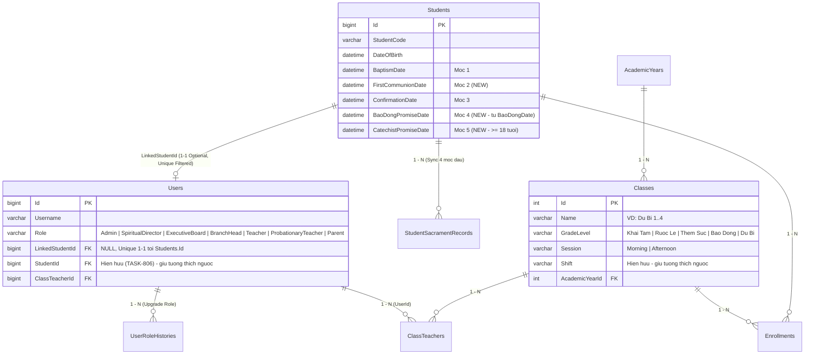
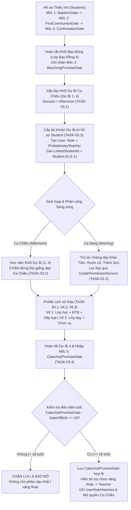

# FEATURE SPECIFICATION: PHÂN TÁCH VAI TRÒ DỰ BỊ & KHỐI CHIỀU — CHUẨN HÓA 5 CỘT MỐC ĐỨC TIN (`FEAT-P6-01`)

> **Trạng thái:** `PLANNED / DESIGN SPECIFICATION (PHASE 6 - V3 FINAL)` *(Chưa triển khai source code C# / EF Core Migration)*  
> **Nguồn đặc tả:** Google Spreadsheet Phase 6 (`1q04ZBxPKqJu8r2XFFdQwm2NAHkOPiEUSjbw4catSIUo` — Sheets: `Danh Sach Task`, `Tong Quan & Quy Tac`)  
> **Quy mô:** `14 Sub-tasks` (`TASK-01.1` ➔ `TASK-04.3`) • Tổng ngày công ước tính: `10.50 Man-days`  
> **Module liên quan:** `UserAccount`, `Security`, `Classes`, `Students`, `Attendance`, `Grades`, `Sacraments`  
> **Bảng Database dự kiến tác động:** `Users`, `Classes` (`ClassRoom`), `Students`, `ClassTeachers`, `FeaturePermissionRules`, `UserRoleHistories`, `StudentSacramentRecords`

---

## 1. Tổng quan Dự án & Bối cảnh Nghiệp vụ (V3 Final)

Trong mô hình Xứ Đoàn Thiếu Nhi Thánh Thể trước Phase 6, hệ thống hiện mới phân tách `Teacher` (GLV chính thức) và `Parent`, đồng thời phân biệt ca Sáng/Chiều chủ yếu bằng logic kiểm tra trực tiếp chuỗi `GradeLevel == "Bao Đồng"` trong `ClassesController`. Giai đoạn **Phase 6 (`FEAT-P6-01`)** giải quyết triệt để bài toán đào tạo **Giáo lý viên Dự Bị (GLV Dự Bị)** vừa học Giáo lý Khối Dự Bị (Ca Chiều), vừa tập sự giảng dạy/trợ tá ở các khối nhỏ (Ca Sáng), thông qua 3 trụ cột:

1. **Phân tách vai trò độc lập (`Teacher` vs `ProbationaryTeacher`):** Thiết lập vai trò `ProbationaryTeacher` liên kết 1-1 với hồ sơ thiếu nhi gốc (`User.LinkedStudentId -> Students.Id`), đồng bộ Policy và cấu hình `FeaturePermissionRules` để sẵn sàng thu hẹp hoặc tùy biến quyền ở các giai đoạn tiếp theo.
2. **Phân định Ma trận Khối & Ca học (`Session`):** Chuẩn hóa thuộc tính `Session` (`Morning` / `Afternoon`) trên thực thể `ClassRoom`, bổ sung Khối `Dự Bị` (`DU_BI`) cố định 4 lớp (`Dự Bị 1` ➔ `Dự Bị 4`) ở ca Chiều, và chặn tuyệt đối việc phân công hoặc truy cập IDOR của `ProbationaryTeacher` vào công tác giảng dạy các lớp ca Chiều.
3. **Chuẩn hóa 5 Cột mốc Đức tin & Tuyên hứa + Profile Lịch sử Kép:** Bổ sung đủ 5 mốc (`BaptismDate`, `FirstCommunionDate`, `ConfirmationDate`, `BaoDongPromiseDate`, `CatechistPromiseDate`), áp dụng ràng buộc cứng **đủ 18 tuổi** tại mốc Tuyên hứa GLV để mở khóa luồng nâng cấp vai trò lên `Teacher`, và hiển thị Timeline song song *Lớp đang học* – *Lớp đang dạy* trên trang Profile.

### 1.1. Bảng Tổng hợp Tiến độ & Ngày công Dự kiến (V3 Final)

| STT | Nhóm Task | Tổng Sub-task | Tổng Ngày Công (Man-days) | Chưa Làm | Đang Làm | Đã Xong | Tỷ Lệ Hoàn Thành |
|---|---|---|---|---|---|---|---|
| 1 | `TASK-01`: Database & Migration | 4 | 2.00 | 4 | 0 | 0 | 0.0% |
| 2 | `TASK-02`: Authorization & Policy | 3 | 2.00 | 3 | 0 | 0 | 0.0% |
| 3 | `TASK-03`: Quản lý Lớp Chiều & Tuyển hứa | 4 | 3.50 | 4 | 0 | 0 | 0.0% |
| 4 | `TASK-04`: Giao diện Profile Lịch sử Kép | 3 | 3.00 | 3 | 0 | 0 | 0.0% |
| **TỔNG CỘNG** | **4 Nhóm Task** | **14** | **10.50** | **14** | **0** | **0** | **0.0%** |

---

## 2. Ma trận Khối & Ca học (Session Matrix)

Hệ thống phân tách rạch ròi hai khung thời gian sinh hoạt nhằm ngăn xung đột giữa giờ đi học của GLV Dự Bị (ca Chiều) và giờ đứng lớp trợ giảng (ca Sáng):

| Ca Học (`Session`) | Các Khối Trực Thuộc | Quy Mô Lớp Học | Vai Trò GLV Chính Thức (`Teacher`) | Vai Trò GLV Dự Bị (`ProbationaryTeacher`) |
|---|---|---|---|---|
| **Ca Sáng (`Morning`)** | `Khai Tâm`, `Rước Lễ`, `Thêm Sức` | Linh hoạt theo sĩ số niên khóa (nhiều lớp mỗi khối) | Giảng dạy chính, chủ nhiệm lớp (`HEAD` / `MEMBER`) | **Được phép** phân công giảng dạy & trợ tá bình thường |
| **Ca Chiều (`Afternoon`)** | `Bao Đồng`, `Dự Bị` (`DU_BI`) | `Bao Đồng` (linh hoạt); Khối `Dự Bị` (**CỐ ĐỊNH 4 LỚP:** `Dự Bị 1`, `Dự Bị 2`, `Dự Bị 3`, `Dự Bị 4`) | Giảng dạy chính, phụ trách quản lý & đào tạo khối Chiều | **CHỈ** tham gia với tư cách Học viên (`Student`). **CHẶN tuyệt đối** phân công dạy ca Chiều |

### Ràng buộc Kỹ thuật Bảo vệ Ca học
- **Ánh xạ tự động:** Khi tạo hoặc cập nhật `ClassRoom`, thuộc tính `Session` tự động suy diễn từ `GradeLevel` (`Khai Tâm`, `Rước Lễ`, `Thêm Sức` ➔ `Morning`; `Bao Đồng`, `Dự Bị` ➔ `Afternoon`).
- **Lọc hiển thị UI:** Dropdown phân công nhân sự tại `ClassesController` / `Views/Classes/` chỉ liệt kê các lớp thuộc ca Sáng cho tài khoản có `Role == ProbationaryTeacher` và loại trừ tài khoản `ProbationaryTeacher` khỏi danh sách chọn GV đứng lớp của khối `Bao Đồng` và `Dự Bị`.
- **Chống truy cập trái phép (IDOR):** Mọi hành động đọc/nhập điểm (`GradesController`) và điểm danh (`AttendanceController`) đều kiểm tra thông qua `IGradePermissionService`: nếu `Role == ProbationaryTeacher`, chỉ cho phép thao tác trên lớp được phân công có `Session == Morning` (`GradeLevel != Bao Đồng` và `!= Dự Bị`).

---

## 3. Quy tắc Chuẩn hóa 5 Cột mốc Đức tin & Tuyên hứa

Chuỗi 5 cột mốc Đức tin & Tuyên hứa mô tả toàn bộ hành trình phát triển của một Thiếu nhi Thánh Thể từ khi gia nhập Giáo xứ đến lúc trưởng thành trở thành Giáo lý viên chính thức:

| Cột Mốc | Tên Cột Mốc Đức Tin & Tuyên Hứa | Trường Dữ Liệu (`Student`) | Đối Tượng & Thời Điểm Ghi Nhận | Điều Kiện & Ràng Buộc Nghiệp Vụ | Tác Động Hệ Thống & Phân Quyền |
|---|---|---|---|---|---|
| **Mốc 1** | Bí tích Rửa Tội | `BaptismDate` | Gia nhập Giáo xứ từ nhỏ hoặc tân tòng | Khởi đầu đời sống Kitô hữu, bắt buộc có Tên Thánh & Ngày rửa tội hợp lệ | Khởi tạo hồ sơ `Student`, làm căn cứ định danh và tính tuổi trong hệ thống |
| **Mốc 2** | Xưng Tội & Rước Lễ Lần Đầu | `FirstCommunionDate` | Hoàn tất Khối Rước Lễ (Lớp `Rước Lễ 2`) | Đã vượt qua kỳ sát hạch giáo lý Xưng Tội - Rước Lễ theo quy định giáo phận | Cập nhật tiến trình học vấn, đủ điều kiện chuyển lên Khối `Thêm Sức` |
| **Mốc 3** | Bí tích Thêm Sức | `ConfirmationDate` | Hoàn tất Khối Thêm Sức (Lớp `Thêm Sức 3/4`) | Lãnh nhận Ấn tín ơn Chúa Thánh Thần do Đức Giám Mục trao ban | Điều kiện tiên quyết để chuyển lên Khối `Bao Đồng` (bắt đầu sinh hoạt Ca Chiều) |
| **Mốc 4** | Tuyên Hứa Bao Đồng | `BaoDongPromiseDate` | Hoàn tất 4 năm Khối Bao Đồng (Lớp `Bao Đồng 4`) | Đổi tên/chuẩn hóa từ `BaoDongDate` cũ. Đánh dấu người tín hữu trưởng thành và dấn thân | Điều kiện bắt buộc để xét tuyển & cấp tài khoản vào Khối `Dự Bị` GLV |
| **Mốc 5** | Hoàn Thành Dự Bị & Tuyên Hứa GLV | `CatechistPromiseDate` | Hoàn tất 4 năm Khối Dự Bị (Lớp `Dự Bị 4`) | **BẮT BUỘC ĐỦ 18 TUỔI** (`CatechistPromiseDate - DateOfBirth >= 18` năm). Hệ thống **chặn lưu và báo đỏ** nếu `< 18` tuổi | Kích hoạt chức năng nâng cấp Role từ `ProbationaryTeacher` lên `Teacher`; cấp quyền giảng dạy toàn diện (bao gồm Ca Chiều) |

> **Ghi chú vận hành Profile:** Trang Profile cá nhân (`Views/Account/Profile.cshtml`) hiển thị chuỗi Timeline trực quan 5 cột mốc kèm **số tuổi tại thời điểm tuyên hứa**; hiển thị cảnh báo trực quan nếu thiếu niên hạn hoặc chưa đủ 18 tuổi.

---

## 4. Thiết kế Kiến trúc Cơ sở dữ liệu & Chiến lược Tương thích ngược (Backward Compatibility)

### 4.1. Sơ đồ Thực thể — Mối Quan hệ Dự kiến (Target V3 Final)

### 4.2. Đối chiếu Hiện trạng Source Code & Chiến lược Tương thích ngược

Do Phase 6 được thiết kế trên nền codebase đã có sẵn nhiều thành phần liên quan từ Phase 1–5, khi triển khai cần bảo toàn hoàn toàn dữ liệu cũ theo bảng đối chiếu sau:

| Thực thể / Tầng | Hiện trạng Source Code Đã Kiểm Chứng (`Verified Current State`) | Thiết kế Phase 6 (`Target V3 Final`) | Chiến lược Tương thích ngược (`Backward Compatibility`) |
|---|---|---|---|
| **`Models/Entities/User.cs`** & **`Data/ParishDbContext.cs`** | Đã có `long? StudentId` + navigation `Student? Student` (thêm từ `TASK-806`, cấu hình `HasOne(u => u.Student).WithMany().HasForeignKey(u => u.StudentId).OnDelete(DeleteBehavior.SetNull)`). | Bổ sung `long? LinkedStudentId` (`BIGINT NULL`, FK `-> Students.Id`, Unique Index filtered để bảo đảm 1-1 giữa User Dự Bị và Student). | Tạo đúng cột `LinkedStudentId` theo V3 Final; các dịch vụ đọc hồ sơ liên kết (như `Profile`) đọc ưu tiên `user.LinkedStudentId ?? user.StudentId` và đồng bộ khi cấp tài khoản Dự Bị để không ảnh hưởng luồng `Parent`/`Student` cũ dùng `StudentId`. |
| **`Models/Entities/UserRole.cs`** & **`Extensions/ServiceCollectionExtensions.cs`** | Có 6 hằng số: `Admin`, `SpiritualDirector`, `ExecutiveBoard`, `BranchHead`, `Teacher`, `Parent`. `RoleGroups.Staff` và Policy `RequireStaff` hiện gồm 5 vai trò (chưa có `ProbationaryTeacher`, chưa có `RequireTeachingStaff`). | Thêm `UserRole.ProbationaryTeacher = "ProbationaryTeacher"`. Cập nhật Policy `RequireStaff` và tách thêm `RequireTeachingStaff` nhận diện độc lập `Teacher` và `ProbationaryTeacher`. | Hiện tại giữ nguyên phạm vi nút/quyền chung tương đương `Teacher` (ngoại trừ khóa Ca Chiều), đồng thời cho phép cấu hình riêng từng nút qua `FeaturePermissionRules`. |
| **`Models/Entities/ClassRoom.cs`** & **`Controllers/ClassesController.cs`** | `ClassRoom` hiện có `string? Shift` (dòng 22) và chưa có `Session`. `ClassesController` (dòng 152, 298, 501, 612) đang kiểm tra trực tiếp `GradeLevel == "Bao Đồng"` để phân biệt sáng/chiều. | Bổ sung `Session` (`Morning` / `Afternoon`), ánh xạ tự động theo khối; bổ sung danh mục khối `Dự Bị` (`DU_BI`) với 4 lớp cố định `Dự Bị 1..4` (`Session = Afternoon`). | Giữ nguyên cột `Shift` trên bảng `Classes` để tránh vỡ migration/view cũ; thiết lập default/backfill `Session = "Afternoon"` cho `Bao Đồng` / `Dự Bị` và `"Morning"` cho `Khai Tâm` / `Rước Lễ` / `Thêm Sức` khi migration. |
| **`Models/Entities/Student.cs`** & **`Models/Entities/StudentSacramentRecord.cs`** | `Student` hiện chỉ có `BaptismDate` (dòng 26) và `ConfirmationDate` (dòng 27). Bảng `StudentSacramentRecords` đã lưu 4 loại Bí tích (`SacramentTypeEnum`: `Baptism=1`, `FirstCommunion=2`, `Confirmation=3`, `ProfessionOfFaith=4`). | Bổ sung trên `Student`: `FirstCommunionDate`, `BaoDongPromiseDate` (đổi nhãn/chuẩn hóa từ `BaoDongDate` trong đặc tả nghiệp vụ), và `CatechistPromiseDate`. | Giữ nguyên `BaptismDate`, `ConfirmationDate` và bảng `StudentSacramentRecords`. Khi cập nhật các mốc 1–4 trên `Student` hoặc từ Sổ bộ Bí tích (`SacramentRegistryService`), thực hiện đồng bộ hai chiều để `StaffStudentLookupService` và `SacramentsController` hoạt động nhất quán. |
| **`Models/ViewModels/`** & **`Views/Students/`** | Hiện có `Models/ViewModels/UserProfileViewModel.cs` (chứa `UserProfileViewModel`, `AssignedClassItemDto`, `TeachingHistoryByYearDto`). Thư mục `Views/Students/` hiện có `Index.cshtml`, `PrintBadges.cshtml` (chưa có `Details.cshtml`). | Bổ sung `ProfileHistoryViewModel` (mở rộng từ `UserProfileViewModel.cs` hoặc tạo `ProfileViewModel.cs`) và giao diện chi tiết/Timeline kép trên `Views/Account/Profile.cshtml` và `Views/Students/Details.cshtml`. | Giữ nguyên các thuộc tính hiện tại của `UserProfileViewModel` (`CurrentClasses`, `TeachingHistory`) để không phá vỡ hành vi hiện hữu của `AccountController.Profile` và `UpdateProfile`. |

---

## 5. Đặc tả Chi tiết 14 Sub-tasks (`TASK-01.1` ➔ `TASK-04.3`)

### 5.1. Nhóm `TASK-01`: Database & Migration (`2.00` ngày công)

| Mã Task | Tên Công Việc | Tầng Xử Lý / Tệp Liên Quan | Mô Tả Chi Tiết & Ràng Buộc Nghiệp Vụ | Ưu Tiên | Ngày Công | Ghi Chú |
|---|---|---|---|---|---|---|
| `TASK-01.1` | Bổ sung vai trò `ProbationaryTeacher` và khóa ngoại `LinkedStudentId` | `Models/Entities/User.cs`, `Models/Entities/UserRole.cs` | Thêm hằng số `UserRole.ProbationaryTeacher = "ProbationaryTeacher"`. Thêm cột `LinkedStudentId` (`BIGINT NULL`, FK `-> Students.Id`) vào bảng `Users` để liên kết tài khoản Dự Bị với hồ sơ thiếu nhi gốc. | Cao | 0.50 | Đảm bảo 1-1 giữa User Dự Bị và Student |
| `TASK-01.2` | Mở rộng danh mục Khối Dự Bị và thuộc tính Ca học (`Session`) | `Models/Entities/ClassRoom.cs`, danh mục `GradeLevel` | Bổ sung khối Dự Bị (`DU_BI`). Thêm thuộc tính `Session` (`Morning` / `Afternoon`) ánh xạ tự động: `Khai Tâm`, `Rước Lễ`, `Thêm Sức` = `Morning`; `Bao Đồng`, `Dự Bị` = `Afternoon`. | Cao | 0.50 | Cố định 4 lớp `Dự Bị 1..4` ở ca Chiều |
| `TASK-01.3` | Cập nhật mốc Tuyên hứa Bao Đồng & Tuyên hứa Giáo lý viên | `Models/Entities/Student.cs` | Chuẩn hóa/bổ sung `FirstCommunionDate` (Mốc 2), `BaoDongPromiseDate` (đổi nhãn/trường từ `BaoDongDate` cũ — Ngày lãnh nhận Tuyên hứa Bao Đồng), và `CatechistPromiseDate` (Ngày Hoàn thành Dự Bị & Tuyên hứa GLV). | Cao | 0.50 | Gộp hoàn thành Dự bị và Tuyên hứa GLV làm 1 cột mốc |
| `TASK-01.4` | Tạo và kiểm thử EF Core Migration | `Data/ParishDbContext.cs`, `Migrations/`, `script/` | Cập nhật Fluent API trong `ParishDbContext` (Index cho `LinkedStudentId` — Unique filtered, `Session`, các trường `*PromiseDate`), tạo EF Core migration và chạy cập nhật trên PostgreSQL. Nếu bổ sung SQL script mới trong `script/`, bắt buộc đặt tên theo chuẩn `{yyyyMMdd}_{TenBang_Hoac_ChucNang}.sql` và chạy trực tiếp được trên **pgAdmin** cho PostgreSQL. | Cao | 0.50 | Kiểm tra tương thích ngược dữ liệu cũ |

---

### 5.2. Nhóm `TASK-02`: Authorization & Policy (`2.00` ngày công)

| Mã Task | Tên Công Việc | Tầng Xử Lý / Tệp Liên Quan | Mô Tả Chi Tiết & Ràng Buộc Nghiệp Vụ | Ưu Tiên | Ngày Công | Ghi Chú |
|---|---|---|---|---|---|---|
| `TASK-02.1` | Tách Policy phân quyền cho `ProbationaryTeacher` | `Extensions/ServiceCollectionExtensions.cs` | Cập nhật các Policy (`RequireStaff`, bổ sung `RequireTeachingStaff`) để nhận diện độc lập `Teacher` và `ProbationaryTeacher`, tách biệt khỏi nhau để sẵn sàng giảm quyền ở phase sau. | Cao | 0.50 | Hiện tại giữ nguyên quyền thao tác như `Teacher` ở Ca Sáng |
| `TASK-02.2` | Đồng bộ cấu hình `FeaturePermissionRules` cho Dự Bị | `Services/FeatureNavigationService.cs`, SeedData | Sao chép bộ quyền hiển thị nút chức năng mặc định từ `Teacher` sang `ProbationaryTeacher` trong bảng `FeaturePermissionRules` để BĐH/Admin dễ dàng bật/tắt từng quyền riêng sau này. | Trung bình | 0.50 | Hỗ trợ quản trị phân quyền động trên UI |
| `TASK-02.3` | Ràng buộc phạm vi lớp giảng dạy theo Ca Sáng | `Services/GradePermissionService.cs`, `Controllers/GradesController.cs`, `Controllers/AttendanceController.cs` | Cập nhật bộ lọc truy vấn lớp được phép thao tác: nếu `Role == ProbationaryTeacher` thì chỉ trả về và cho phép thao tác trên các lớp được phân công thuộc Ca Sáng (`Session == "Morning"`, tức `GradeLevel != Bao Đồng` & `!= Dự Bị`). | Cao | 1.00 | Chặn truy cập trái phép qua URL (IDOR) |

---

### 5.3. Nhóm `TASK-03`: Quản lý Lớp Chiều & Tuyển hứa (`3.50` ngày công)

| Mã Task | Tên Công Việc | Tầng Xử Lý / Tệp Liên Quan | Mô Tả Chi Tiết & Ràng Buộc Nghiệp Vụ | Ưu Tiên | Ngày Công | Ghi Chú |
|---|---|---|---|---|---|---|
| `TASK-03.1` | Tạo nhanh 4 lớp chuẩn Khối Dự Bị (Ca Chiều) | `Controllers/ClassesController.cs`, `Views/Classes/` | Hỗ trợ nút/luồng khởi tạo nhanh 4 lớp cố định: `Dự Bị 1`, `Dự Bị 2`, `Dự Bị 3`, `Dự Bị 4` thuộc Khối Dự Bị, mặc định `Session = Afternoon` khi mở niên khóa mới. | Trung bình | 0.75 | Có thể tùy chỉnh thêm nếu cần |
| `TASK-03.2` | Chặn phân công Dự Bị dạy các lớp Ca Chiều | `Controllers/ClassesController.cs`, `ClassTeachers` | Thêm validation khi gán nhân sự vào lớp: chặn tuyệt đối tài khoản có `Role == ProbationaryTeacher` đứng tên giảng dạy ở các lớp thuộc Ca Chiều (`Bao Đồng` và `Dự Bị`), đồng thời lọc khỏi dropdown chọn GV Ca Chiều. | Cao | 0.75 | Chỉ cho phép Dự Bị dạy/trợ tá lớp Ca Sáng |
| `TASK-03.3` | Luồng "Cấp tài khoản Dự Bị" từ hồ sơ Thiếu nhi | `Controllers/StudentsController.cs`, `Controllers/UsersController.cs` | Bổ sung nút cấp tài khoản Dự Bị ngay trên hồ sơ học viên đã xếp vào Khối Dự Bị: tự động tạo `User` với `Role = ProbationaryTeacher` và gán `LinkedStudentId = Student.Id`. Kiểm tra chặn tạo trùng tài khoản cho 1 học viên. | Cao | 1.00 | Tránh tạo trùng tài khoản cho 1 học viên |
| `TASK-03.4` | Form cập nhật Ngày Tuyên hứa GLV (`>= 18` tuổi) & Nâng cấp Role | `Controllers/StudentsController.cs`, `Views/Students/` | Nhập `CatechistPromiseDate`, tự động tính tuổi (`CatechistPromiseDate - DateOfBirth`), **chặn lưu và báo đỏ** nếu `< 18` tuổi. Khi lưu hợp lệ, hiển thị tùy chọn nâng cấp Role từ `ProbationaryTeacher` lên `Teacher` (kèm ghi nhận `UserRoleHistories`). | Cao | 1.00 | Ràng buộc cứng tối thiểu 18 tuổi |

---

### 5.4. Nhóm `TASK-04`: Giao diện Profile Lịch sử Kép (`3.00` ngày công)

| Mã Task | Tên Công Việc | Tầng Xử Lý / Tệp Liên Quan | Mô Tả Chi Tiết & Ràng Buộc Nghiệp Vụ | Ưu Tiên | Ngày Công | Ghi Chú |
|---|---|---|---|---|---|---|
| `TASK-04.1` | Xây dựng `ProfileHistoryViewModel` & Service tổng hợp đa niên khóa | `Models/ViewModels/UserProfileViewModel.cs` *(hoặc `ProfileViewModel.cs`)*, `Services/` | Truy vấn hợp nhất lịch sử học tập (`Enrollments` + `GradeRecords`/`StudentGradeSummaries`) qua `LinkedStudentId` và lịch sử giảng dạy (`ClassTeachers`) qua `UserId`, nhóm theo từng Niên khóa (`AcademicYear`). | Cao | 1.25 | Hiển thị xuyên suốt `Khai Tâm` ➔ `Dự Bị` ➔ `GLV` |
| `TASK-04.2` | Thiết kế giao diện Timeline song song Lớp Học & Lớp Dạy | `Views/Account/Profile.cshtml`, `Views/Students/Details.cshtml` *(tạo mới/bổ sung)* | Hiển thị thẻ từng niên khóa với 2 vế song song (từ giai đoạn Dự Bị trở đi): **Vế 1** là Lớp đang học (Ca Chiều + ĐTB + Xếp loại), **Vế 2** là Lớp đang dạy (Ca Sáng + Chức vụ `HEAD`/`MEMBER`/`DEPUTY`). | Cao | 1.25 | Trực quan, dễ theo dõi cả quá trình |
| `TASK-04.3` | Hiển thị 5 Cột mốc Đức tin & Tuyên hứa trên Profile | `Views/Account/Profile.cshtml` | Hiển thị chuỗi 5 cột mốc: `1. Rửa Tội` ➔ `2. Xưng Tội/Rước Lễ` ➔ `3. Thêm Sức` ➔ `4. Tuyên hứa Bao Đồng` ➔ `5. Hoàn thành Dự Bị & Tuyên hứa GLV` (kèm số tuổi tại thời điểm tuyên hứa). | Trung bình | 0.50 | Hiển thị cảnh báo nếu chưa đủ 18 tuổi |

---

## 6. Luồng Nghiệp vụ Cốt lõi (End-to-End Lifecycle)

---

## 7. Ghi chú Kiểm định & Đồng bộ `AI-Knowledge`

- **Trạng thái hiện tại:** Toàn bộ 14 sub-tasks trong tài liệu này đang ở trạng thái **Thiết kế đã chốt (`PLANNED / V3 FINAL`)**, chưa chỉnh sửa mã nguồn C# hay cấu trúc PostgreSQL thực tế.
- **Quy tắc nhất quán chỉ mục:** Theo `AI-Knowledge/AI-KNOWLEDGE-STRUCTURE.md`, các tệp máy đọc phản ánh mã nguồn hiện hành (`02-DATABASE/TABLE-INDEX.json`, `03-CODE-INDEX/*.jsonl`) **không** ghi nhận trước các symbol/cột chưa tồn tại ở trạng thái code hiện tại; chỉ cập nhật các tệp này và `KNOWLEDGE-BASELINE.json` ngay sau khi hoàn tất lập trình & EF Core Migration cho từng nhóm Task `TASK-01` ➔ `TASK-04`.
